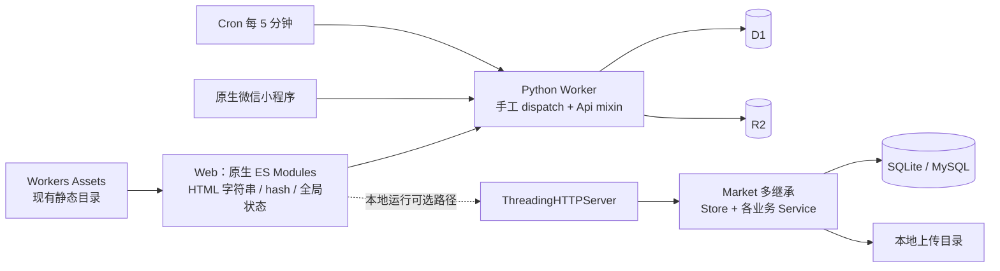
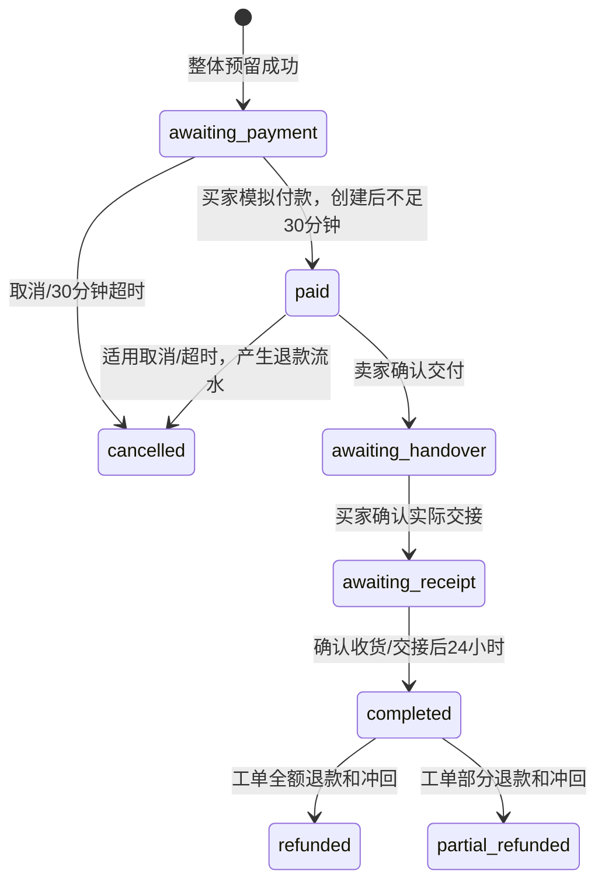

# 01 现状审计与业务基线

核对日期：2026-10-21。这里的结论以本地 Git 对象和文件为依据；分支名称中的 `origin/` 是本地保存的远程跟踪引用，本轮未重新 fetch。

## 1. 最新基线与历史分支

当前分支 `release/2026-10-trial-hotfix`，HEAD `b2b6266`。开始编写前工作区干净。与 10 月 20 日旧审计相比，当前包含完整 Cloudflare 业务、好友表和年级字段修补、备份好友清单、聊天好友前置修正、首页分页、双窗口轮播、社区界面、五槽手机导航、紫色 ZJ 品牌。

| 分支/提交 | 可用能力及差异 | 缺口/测试证据 | 与线上关系 | 处理建议 |
| --- | --- | --- | --- | --- |
| 当前 hotfix `b2b6266` | 当前最新交互；Cloudflare 业务较完整；修复好友 schema/备份 | 仍是原生 Web、手工路由、多继承与双份业务；本轮复测见 §3 | 发布文档有上线说明，本轮未核对部署 ID | **实施起点**，保留本版行为和素材 |
| `master@fcbbd40` | 本地 HTTP 服务、SQLite/MySQL、聊天重发修复、原用户端功能 | 不包含当前完整云端路径和新界面 | 不能因默认分支而认定线上在运行它 | 业务回归参考，不作为最新实现覆盖源 |
| `fix/auth-client-kdf@09305a5` | 部分 D1/R2、客户端密码派生 | 多个未移植接口返回 501 | 未核实 | 仅研究历史认证和适配选择 |
| `main@f8033e0` | catalog/trade/community/staff/auth/read_pages 与云端测试 | 历史导入依赖缺失；当前分支已带会话策略文件 | 未核实 | 不单独选作基线 |
| `refactor/spec-v1-structure@523def5` | 交易、通知、评价等文件拆分 | 仍有 mixin；缺少最新 UI/热修复；旧 schema/好友测试问题已在当前分支修正 | 未核实 | 按语义复用，禁止整分支覆盖 |
| checkpoint `b88fd04`、trial `9dd8298`、旧 hotfix `565a96f` | 中间备份/发布快照，后者含求购及论坛修补 | 新版已在其上继续演进 | 历史发布线索 | 用于定位差异与必要的回退分析 |
| community-redesign `9d2c080` 相关历史 | 社区、论坛求购入口和手机导航 | 已通过 `6e5e80e` 合入当前版本 | 未核实 | 避免重复实现或再次覆盖 |

关键新提交：`3395b97` 修补云端 schema/备份；`395fd11` 首页与商品流；`19018f8` 双专题；`147afbb` 五槽手机导航；`6e5e80e` 合并界面成果；`b2b6266` 品牌统一。上述“已包含”来自本地提交，不表示本轮验证过线上效果。

旧的“当前好友表不存在”“所有云端测试因缺少 session_policy 无法导入”“启动失败会一律清除登录”等结论，**不适用于当前 HEAD**：schema 已包含 `friendships` 和 `users.grade`，备份包含好友，`main.js` 仅在明确 401 时清除会话。

## 2. 读取范围与当前架构

本轮重读了当前入口、Market、Cloudflare 配置、D1 包装、schema、认证/会话、交易守卫、媒体读取、商品发布、首页/导航/轮播/HTTP/启动、相关测试与新发布设计；结合前次已读的账号、商品、交易、社区、工单、人员、审核、运维、小程序和需求材料作整体设计。未对每个历史分支的每一行做重新审查。

两条 Python 路径并存，不能画成“本地 server 直接使用 D1”。当前 Wrangler 的 DB、MEDIA 均配置 `remote: true`；**直接运行现配置开发可能访问远程资源**。实施时必须先生成独立的本地/测试配置，不能默认 `wrangler dev` 安全隔离。

当前认证、支付、媒体、任务的事实：手机号/邮箱未验证；交易、付款、退款、费用和账本均为模拟；站内未读提醒已实现，浏览器/微信系统推送未接入；R2 代码和绑定已存在，但本轮没有验证实际线上对象、权限或套餐。

## 3. 验证证据及范围

本轮使用 `git archive HEAD` 导出独立临时快照，清除子进程中的 `HC_DB`、`HUALI_*` 等数据配置后测试，未在真实库上执行。运行环境为本机可用的 Python 3.12.14、Node 24.21.0；与发布说明记录的 Python 3.12.7 环境不同。

| 本轮执行 | 结果 | 解释 |
| --- | --- | --- |
| `python -B -X utf8 -m unittest discover -s tests -p test_*.py` | 462 项，3 failure、1 error，约 156 秒 | 全部失败集中在 `test_trial_launcher` 的依赖就绪检查；该解释器有 Pillow 12.3.0、缺 PyMySQL；尚未补装依赖或将本轮结果标为全绿 |
| `tests/*.test.mjs`、`tests/*.test.js` | 10 个脚本退出码均为 0 | forum_ui、frontend_modules、home_feed、home_promos、native_client、native_order、native_trial_auth、persistent_session、site_transport、user_center |
| ES 模块自检 | 54 个模块可加载且无依赖环 | 仅证明当前原生模块可加载，不能证明 Vue 或完整浏览器业务 |
| 真实 Workers/D1/R2、浏览器视觉、小程序真机 | 本轮未执行 | 列入后续专门验收，不复用旧发布记录冒充本轮结果 |

临时日志位置为 `C:/Users/90442/AppData/Local/Temp/huali-plan-20261021-pgkw5173/`，便于本机排查，不作为永久可携带交接依赖。后续 T00 在项目固定环境重跑并把脱敏结果登记到长期验证记录。

仓库发布说明记载 462 项 Python 回归、Node 与浏览器验证；这是**既有记录**，不能替代本轮结果。SQLite/内存 D1 模拟器不限制每条 SQL 的 100 个绑定参数，也不等于 Python Workers/FFI、真实 D1、R2 或微信真机测试。

## 4. 问题与优先级

P0：影响交易/凭据/私密数据，应在对应生产迁移前修复并独立验收。P1：架构、稳定性或成本问题，应进入相应切片。P2：体验与长期治理。

| 编号/级别 | 文件与符号 | 已核实事实与后果 | 验证/处理 |
| --- | --- | --- | --- |
| A01 / P0 | `app/cloudflare/trade_api.py::cf_trade_checkout` | 一件商品在总守卫中增加 13 个参数，加买卖双方共 `2+13N`；8 件达 106，超过 D1 单语句上限；接口允许 20 件 | 静态计数及官方限额；改为低参数守卫，真实 D1 测 8/20 件，禁止拆成部分提交 |
| A02 / P0 | 同上幂等重放和异常分支 | 正常重放比较遗漏 `want_id`，依赖可变订单明细；异常后查到旧单直接返回，未比较请求内容；重放前还会重新校验预约是否在未来 | 保存不可变请求摘要；所有返回旧结果路径先核对摘要；超时后原键重试 |
| A03 / P0 | `app/cloudflare/api.py::login/register` | 客户端 digest 直接与存储 digest 比较，数据库 verifier 泄漏即可成为可重放登录凭据 | 保留旧账号数据，迁移服务端标准 KDF 验证；平台成本先验证，不能靠降低轮数解决 |
| A04 / P0 | `api.py::media` | 非私密上传只要被任意订单 JSON 引用，就允许匿名读取并公有缓存；私密凭证对所有平台员工放行，未绑定案件上下文 | 改为媒体关系和资源授权；订单历史、凭证、预览测试第三人/无关客服访问拒绝 |
| A05 / P1 | `app/market.py::Market`、本地 Service、云端 Api | 多继承使跨域 `self.*` 隐式互调；业务在本地和 Worker 重复 | 显式服务与组合根；跨域事务由用例统一提交；禁止再复制第三套规则 |
| A06 / P1 | `cloudflare/d1.py` 文档、`guarded_batch/expect` | 现有约束失败守卫有事务内防护；顶部示例却描述 batch 完成后 expect 可保证整体正确，容易被照抄 | 保留已证明的约束回滚思路，独立断言设施；提交后 expect 不能回滚，测试整批失败 |
| A07 / P1 | `core/session_policy.py`、本地 `user`、云端 `current_user_id` | 已统一新会话 30 天，当前两条读取路径均无滑动续期；旧 master 的滑动实现不能直接当作当前行为 | 明确 TTL 与续期阈值，补时钟边界、撤销和多端测试 |
| A08 / P1 | `catalog/service.py::products`、云端 `read_pages.py`、订单 DTO | 列表读取后做 Python 过滤/逐项查询，订单附属数据逐单获取；免费送/收藏仍有全量读取路径 | SQL 分页、分组查询、索引和查询预算，不能只做前端无限滚动 |
| A09 / P1 | `catalog_api.py::cf_catalog_publish` | 云端 clean 白名单缺少本地已支持的品牌/型号/保修/尺寸/材质等分类属性 | 统一 DTO 与分类字段表，补两端行为合同，迁移不能丢字段 |
| A10 / P1 | `staff_api.py::cf_staff_backup`、`trade_api.py::cf_trade_tick` | 备份仍在内存构建带上限的 ZIP；定时扫描及批量规模需要边界；好友已补入备份 | 有界后台作业、备份 manifest 和恢复演练；不把当前 ZIP 等同长期备份策略 |
| A11 / P1 | `core/http.js`、全局 state、messages | 全局 renderId 使翻页与请求生命周期耦合；虽然首页已有局部销毁保护，其他模块仍须迁移 | 会话 epoch + 资源级取消；写请求未知结果按幂等查询，账号隔离 |
| A12 / P2 | 多份 CSS、`home.css`、轮播 | 样式层叠重复；首页价格金棕与全局珊瑚红并存；双轮播当前明确持续播放且无暂停 | 设计令牌和组件替代覆盖链；轮播改善属于独立体验变更，不能冒充纯重构 |

A01/A02/A03/A04 的源码路径已确认；本轮未通过真实线上请求复现。它们对应明确的结构或协议问题，不据此猜测线上已经发生数据损失。发布缺陷修复时，应给出独立复现、兼容与回滚说明。

## 5. 必须保留的业务与交互

| 领域 | 当前必须保留的能力/规则 | 归属目标 |
| --- | --- | --- |
| 账号 | 手机/邮箱密码、恢复码、改密/退出、状态限制、会话撤销、旧凭据；四级平台角色；资料版本与头像 | identity |
| 商品 | 四分类及各自属性、3–9 张本人不同图片、front/side/top、私密凭证、收藏点赞报价、置顶、不同来源下架 | catalog + media |
| 订单 | 同卖家 1–20 件、金额整数分、送货费最高项一次、价格/地点/图片快照、付款前修改、付款后双方改约 | trade |
| 售后账务 | 模拟支付/结算/全额及部分退款/冲回；工单处理与利益冲突；退款后商品保持下架 | support + trade |
| 求购 | 发布与匹配、好友申请上下文、取消/超时/退款回滚、5% 模拟服务费及冲回 | community.wants + trade 工作流 |
| 社区 | 新版社区和独立论坛、论坛求购入口、帖子评论/回复、主动入群、学院群分流、群角色 | community |
| 聊天 | 好友申请/15 字短附言、普通私聊好友门槛、客服豁免、拉黑/禁言/撤回/隐藏/移除、重试同键、未读 | community.chat |
| 平台治理 | 工单、内部/公开回复、复核、下架/理由/通知/审计、信誉处罚、人员等级、词库与审核 | support / staff / reputation / moderation |
| 个人与提醒 | 公开主页、脱敏档案、信誉星级与标签、账号隔离草稿/清单、站内通知和角标 | identity / reputation / notifications |
| 运维与客户端 | 备份恢复/对账/审计导出；中文空格 Windows 路径；原生小程序 API 合同 | ops / compatibility |
| 新版界面 | 紫色 ZJ、暖黄操作色、双窗口各三专题、首页 24 件追加去重/失败重试/收藏保位、五槽导航与右上头像 | Web 迁移视觉及交互基线 |

草稿当前属于本地能力，不能宣传为跨设备同步；免费商品不等于送货免费。历史公开演示仍然只读、使用虚构数据。新架构不包含真实支付、短信、实名、物流、自动图片识别或系统推送。

信誉从源码提取并锁定为行为样例：初始 100、低于 60 禁止发布；已实现好评加分及日/月上限、处罚档位和价格附加值、星级/诚信标签。`account/credit.py` 为参数和边界的直接依据；不要把旧方案中尚未实现的 0.5 分奖励或其他提议当作现有能力。信誉事件按 Asia/Shanghai 的日/月边界计算，迁移时补时区行为测试。

## 6. 订单状态机与不变量

图省略售后从其他可售后状态进入的分支，实施须以完整用例表覆盖，而非只实现图上箭头。关键规则：卖家 24 小时窗口从 `paid_at` 起算；买家确认交接后才设置 `handover_at` 并启动自动收货；未结售后暂停自动收货。卖家单方面交付不等于结算。

取消/超时释放商品必须同时匹配 `reserved` 和该订单的预留关系；卖家非 active、平台下架、退款下架不得自动变回 available。求购恢复必须是本订单占用的匹配。订单、预留、账本、匹配、审计与站内通知属于同一原子提交。

## 7. 权限模型与规则分歧

权限同时判断 actor 状态、平台角色、资源归属、操作状态和利益冲突。群 owner/admin/member 是独立维度，不能获得平台人员权限。下表是目标合同；与现实现不一致的项必须先登记 RULE，不能当作纯结构迁移。developer 仍应服从业务参与冲突和本人保护。

| 操作 | user | support | admin | developer | 额外条件 |
| --- | --- | --- | --- | --- | --- |
| 商品/订单自助 | 本人 | 本人 | 本人 | 本人 | 服从交易状态和平台处置锁 |
| 平台商品下架 | 否 | 是 | 是 | 是 | 原因/审计/通知；客服本人商品走自助 |
| 工单处理/模拟退款 | 否 | 是 | 是 | 是 | 不处理本人发起、参与或有利益关系的案件 |
| 信誉处罚/账号封禁 | 否 | 否 | 是 | 是 | 核实工单、原因、防重复和利益冲突 |
| 平台账号停用/重置/降级 | 否 | 否 | 低于本人等级 | 低于本人等级 | 不能对自己、同级/更高；最后有效开发者保护 |
| 账号清除/匿名化 | 否 | 否 | 支持低等级目标 | 支持低等级目标 | 当前本地源码已含等级规则，保留历史关联；两端合同再核对 |
| 私密媒体/内部备注 | 资源授权后 | 案件授权后 | 案件授权后 | 案件授权后 | 角色本身不能替代资源权限 |
| 群管理 | 群角色授权 | 群角色授权 | 群角色授权 | 群角色授权 | 群角色与平台角色分别判定 |

以下分歧登记为决策项，不通过重构悄悄统一：平台下架恢复权限在旧文档与代码有差异；客服能否查看全部脱敏档案在两端有差异；云端部分人员管理允许 developer 旁路等级限制，而目标建议禁止操作同级；封禁用户申诉入口与禁止登录冲突；当前固定 30 天与建议滑动续期有差异；部分退款是否全额冲回求购服务费需锁定现行规则。实施 T00 逐项形成最小样例和选择记录。相关模块上线前确认，其他模块继续推进。

## 8. 线上待核实项

实际运行提交/Cloudflare Version ID、D1 权威库及现存迁移历史、R2 bucket/私有访问、环境变量/套餐/容量、是否存在仍在使用的 SQLite/MySQL、可恢复备份与小程序已发布客户端版本。本轮只记录配置和发布文档线索，不连接真实数据库验证。
