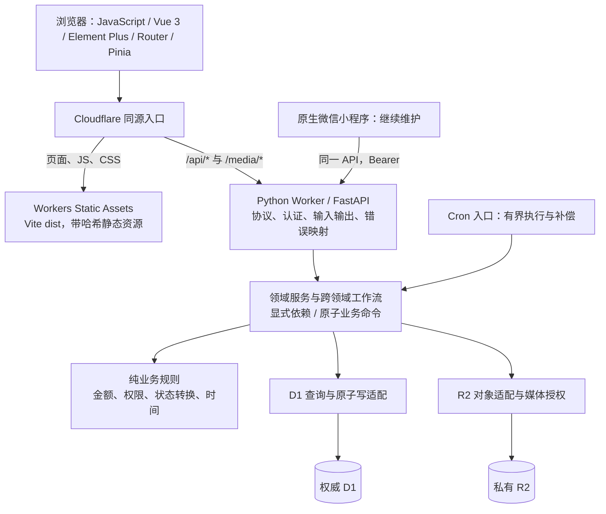
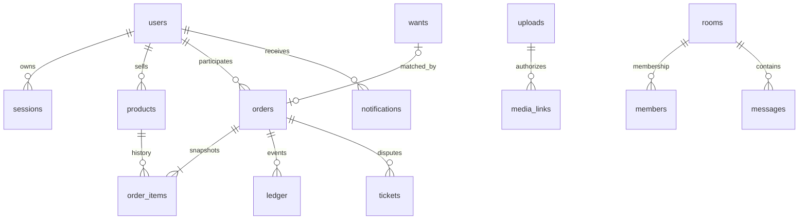

# 02 目标架构与数据设计

日期：2026-10-21。下文为目标设计，代码片段是实施约束与伪代码，尚未作为业务代码运行。

前端语言按用户最新决定调整为 JavaScript + Vue 3 + Element Plus，详见 [0004](./decisions/0004-javascript-element-plus.md)。Python/FastAPI、数据边界与分阶段迁移要求继续适用。

## 1. 总体结构与部署

选择模块化单体：一个业务发布单元、一个权威 D1、一个私有 R2，以业务职责分模块。模块内可以直接调用纯函数或显式服务接口；跨模块且涉及多个写入的动作由一个应用用例拥有完整提交权。



浏览器以同源 Cookie 为目标；小程序继续通过同一认证/授权服务使用 Bearer。静态资源直出，不通过 Python 读取整个前端目录。`/api`、`/api/*`、`/media`、`/media/*` 必须在配置测试中验证；API 404 返回 JSON，不能落入 SPA HTML。

Python Worker 不保留 ThreadingHTTPServer、守护线程、持久本地目录和 SQLite 文件锁。`threading/multiprocessing` 在该运行时不能正常工作，文件系统为临时内存文件系统。[官方标准库说明，核实于 2026-10-21](https://developers.cloudflare.com/workers/languages/python/stdlib/)

## 2. 平台证据与必须先通过的技术门槛

| 主题 | 已能从官方材料确认 | 本项目仍需实证 |
| --- | --- | --- |
| FastAPI | 官方提供 ASGI 入口，示例为 `from workers import asgi; Default = asgi.entrypoint(app)`；bindings 通过 request scope 获取 | 与 scheduled 的组合、依赖版本、异常和 Cookie 行为 |
| Python 依赖 | 纯 Python、Pyodide 适配包与相应 wheel 有平台约束 | Pillow 对应版本、EXIF/WebP、标准 KDF 实现与性能，不能拿普通 CPython 安装成功代替 |
| D1 | binding 异步访问；batch 内 SQL 出错会整批回滚 | Python FFI 返回值、约束错误映射、100 参数、所有失败路径和并发 |
| Worker 资源 | 内存 128 MB；HTTP CPU 预算随计划不同，免费与付费差别大 | 最大合法图片/KDF 在目标套餐下的 CPU、峰值内存和冷启动 |
| 静态与调度 | 支持 Assets SPA 路由及 Cron；定时按 UTC 配置 | API 不回 HTML、深链刷新、漏跑补偿、同一任务重复执行 |

来源：[FastAPI](https://developers.cloudflare.com/workers/languages/python/packages/fastapi/)、[依赖](https://developers.cloudflare.com/workers/languages/python/packages/)、[Python FFI](https://developers.cloudflare.com/workers/languages/python/ffi/)、[D1 batch](https://developers.cloudflare.com/d1/worker-api/d1-database/)、[Workers 限制](https://developers.cloudflare.com/workers/platform/limits/)、[SPA 路由](https://developers.cloudflare.com/workers/static-assets/routing/single-page-application/)、[Cron](https://developers.cloudflare.com/workers/configuration/cron-triggers/)。核实日期 2026-10-21；依赖/FFI/路由/Cron 细节沿用前次官方核对并要求 T01 再验证，未宣称运行通过。

**PoC 退出标准：** 一个隔离 Worker 用 FastAPI 读写隔离 D1；构造第 N 条失败证明此前写入归零；使用 R2 上传/读取并拒绝越权；与旧账号算法的标准测试向量一致；最大合法图片保持既有三视图和解码校验；定时入口重复调用不重复记账；Vue 深链及静态请求正确。记录包版本、compatibility_date、CPU/内存、响应与日志，不能只有截图或“本地正常”。

旧 crypto.py 中关于 KDF API 缺失、WebCrypto 轮数和 pycryptodome 超限的注释是历史经验，作为 PoC 的复现输入，不能直接当成当前平台的普遍结论。保留既有 600000 轮凭据验证强度，不自行发明密码算法。

**有条件备选：** 若维护中的 KDF/图片依赖在真实 Worker 上无法满足既有能力和资源预算，业务整体使用外部托管 FastAPI；D1 仍保留，通过一个受保护的窄 Worker 操作边界提交受限命令。边界只接受白名单操作和严格 schema，服务端认证、重放保护和审计齐全；绝不暴露任意 SQL 或 Cloudflare Token。该方案增加网络一跳、部署与服务间认证成本，只有 PoC 记录了具体阻碍才启用。规则仍只有一份，D1 Worker 只负责受限数据操作及原子约束。

## 3. 模块职责与依赖方向

| 模块 | 拥有的职责/数据 | 不应承担的职责 |
| --- | --- | --- |
| identity | 用户、凭据、会话、资料、状态和角色事实 | 直接编写订单退款 SQL |
| catalog | 商品、分类属性、报价、反应、上下架规则、商品查询 | 管理 R2 bucket 或自行结算 |
| trade | 订单、明细快照、预留关系、改约、模拟账本、截止时间 | 决定工单利益冲突或词库 |
| community | 论坛/求购/好友/群/聊天，分为内部子模块 | 获得平台人员或资金权限 |
| support | 工单、证据关系、内部备注、认领和复核 | 绕过 trade 直接变更资金状态 |
| reputation | 信誉事件、处罚与好评奖励、星级标签 | 因举报直接扣分 |
| staff | 平台人员管理、等级和本人保护 | 群管理角色授权 |
| moderation | 场景审核、风险级别、治理规则 | 对用户输出命中词详情 |
| notifications | 站内通知、已读和通知未读 | 承担聊天查询/系统推送 |
| media | 上传元数据、对象关系、资源鉴权、清理 | 仅根据员工角色公开所有证据 |
| ops | 对账、备份清单、恢复、作业和运行观测 | 混入商品或工单业务规则 |

依赖约束：`api → application/service → rules + ports`；`infrastructure` 实现 ports；`bootstrap` 装配服务。rules 不导入 FastAPI、workers、Market、数据库 binding。模块的其他模块依赖只通过公开的 service/port/DTO，不 import 对方内部 repository 或私有 helper。

跨域工作流显式命名，例如 `CheckoutOrder`、`ResolveRefundTicket`、`BanAccountAndResolveOrders`。`ResolveRefundTicket` 同时检查工单、actor、利益冲突和订单，然后由 trade 的原子写入口提交一份完整决定。不能 SupportService 提交工单后再独立调用 TradeService 提交退款。

站内通知与业务事件存在同一 D1，直接纳入同 batch；现在无需引入消息队列。未来真正接入外部推送时，再增加事务内 outbox 和幂等投递消费者，不预建空架构。

## 4. 目录与旧新映射

```text
huali-corner/
├─ apps/
│  ├─ api/
│  │  ├─ pyproject.toml                 # 明确运行时与锁定依赖
│  │  └─ src/huali/
│  │     ├─ main.py / bootstrap.py      # 入口与唯一装配位置
│  │     ├─ modules/
│  │     │  ├─ identity/               # api.py schemas.py service.py rules.py ports.py
│  │     │  ├─ catalog/ / trade/ / support/
│  │     │  ├─ community/              # forum/ wants/ friends/ chat/
│  │     │  └─ reputation/ staff/ moderation/ notifications/ media/ ops/
│  │     ├─ application/workflows/     # 必须跨领域编排的用例
│  │     ├─ infrastructure/
│  │     │  ├─ d1/                    # client、各领域查询/原子写适配
│  │     │  └─ r2/                    # binding、媒体对象操作
│  │     └─ shared/                   # 少量时钟、错误、ID、金额基础类型
│  └─ web/
│     └─ src/
│        ├─ app/                     # router、providers、启动和全局样式入口
│        ├─ layouts/                 # MarketLayout / WorkspaceLayout / AuthLayout
│        ├─ features/                # 与业务命名一致，内部 pages/components/api/composables
│        └─ shared/                  # ui、http、类型、格式化、design-tokens
├─ clients/miniprogram/              # 最后阶段迁移目录，原生技术继续保留
├─ infra/d1/migrations/              # 编号 SQL，迁移历史
├─ infra/cloudflare/                 # local/test/production 配置隔离
├─ contracts/                        # 生成的 OpenAPI 和行为样例
├─ tests/                            # unit / contract / worker / e2e / migration
├─ scripts/                          # 跨平台开发与验证入口
└─ docs/refactor/
```

这是逐阶段形成的目标目录，不先建立所有空文件。先新增 apps/api 和 apps/web 的最小切片；旧 `Backend mission`、`web 7M` 路径在兼容阶段保留。最后更新启动、部署、素材、测试引用后再移动小程序和退役旧代码。

| 旧文件/组织 | 目标落点与迁移方式 |
| --- | --- |
| `server.py` / `cloudflare/api.py::dispatch` | FastAPI 分领域 router；旧 `/api` adapter 保留既有 DTO |
| `market.py` | 临时 facade 转发到显式服务；新模块禁止运行时依赖 Market；最后移除 |
| 本地 trade + cloudflare/trade_api | 先提取纯状态/金额规则，再建立一个 D1 业务写入口，旧调用逐步转发 |
| `core/database.py` / `cloudflare/d1.py` | D1 client + 明确事务操作；SQLite 用于遗留运行及快速测试，不伪装 D1 交互事务 |
| pages + actions + 字符串组件 | feature 内 Vue 页面/组件/composable；事件通过 props/emits 和函数调用 |
| state/http/session | 领域 store、sessionEpoch、统一 typed HTTP client；不照搬全局 renderId |
| 各 CSS 尾部覆盖 | tokens → 基础组件 → 布局 → 页面局部样式，逐页替换 |
| miniprogram | 保留原生，新增接口兼容及认证适配；不宣称会自动变成 Vue |

## 5. 数据模型和约束

以现存表和主键为迁移基点，保留所有历史关系。先扩展，再回填和校验，再切换读写，最后清理旧列。不要因为新目录就建一个空库替代现用 D1。



关系图表达业务关系，不承诺所有旧表已有外键；`users/orders` 的买方/卖方是两个具体关系。迁移先查孤儿记录，再补适当外键、唯一键和 CHECK，不得靠忽略导入错误“修复数据”。

| 表/结构 | 具体设计 |
| --- | --- |
| products | 保留现有机器状态；增加 version、reserved_order_id、removal_source/reason；任何涉及交易的修改递增 version |
| products.data | 分类扩展属性继续 JSON，服务端按 category schema 校验；交易过滤/排序字段使用结构化列；不盲目全拆表 |
| orders / order_items | 保留原订单 items 快照，增加结构化 order_items 用于商品关系/预留/媒体；明确 source/version，切换后一个来源写入，不长期双写漂移 |
| orders | version、各状态时刻及明确截止时间；买家/卖家/地址/价格/送货费/图片为成交快照；历史不随商品编辑改变 |
| wants | version、matched_order_id，恢复时比较归属；禁止只看 status=matched 就释放 |
| ledger | 金额整数分、事件唯一标识；保留原 `(order_id,kind)` 合同，迁移前不引入重复部分退款等新规则 |
| idempotency_keys | `(actor_id,scope,key)` 唯一、不可变 request_hash、resource_id、response_json、created_at、有效/保留策略 |
| tx_assertions | 事务内条件断言，见 §6；成功 batch 内清除，不承载业务记录 |
| uploads / media_links | owner、digest、object_key、状态、scope、关联资源；不再用 JSON LIKE 决定访问权 |
| friendships | 保留既有申请与同意语义；规范相互申请/接受并发唯一性前先处理历史重复，禁止丢弃好友关系 |
| messages | 保留 `(sender,room,client_key)` 唯一；内容摘要/版本或变更游标支持旧消息撤回同步 |
| jobs / audit | 有界清理/备份作业与可审计 actor、资源、原因、request_id；不记录明文凭据 |

类型决策：数据库历史主键不全量重编号；新版本 API 将 ID 作为字符串处理，兼容层继续旧数字类型；新生成数值 ID 必须在安全整数范围。金额名称新接口带 `_cents`，拒绝 bool/负值/非整数及超界值。DB 原有 REAL 秒先保留并通过统一时钟适配；新 v1 API 约定 UTC epoch 毫秒，禁止同字段混用单位，转换要有快照测试。展示和信誉日/月结算使用 Asia/Shanghai。

索引随查询落地：商品 `(status,category,created,id)`、`(seller_id,created,id)`；订单 `(buyer_id,created,id)`、`(seller_id,status,created,id)` 及各截止任务索引；order_items(product_id,order_id)；members(user_id,room_id)、messages(room_id,id)、notifications(user_id,read_at,id)、tickets(status,assignee,created,id)、sessions(user_id,expires)、media_links(upload_id,resource_type,resource_id)。按真实 WHERE/ORDER BY 调整，并提供 EXPLAIN 与 rows_read 证据，避免为了“有索引”给每列都建索引。

列表默认 24、最大 50；聊天/审计最大 100。目标 API 用 keyset 游标，按 `(created,id)` 或明确递增消息序列排序；现有随机订单 ID 不能代表时间。D1 每条 SQL 最多 100 个绑定参数、100 KB SQL，单库按序处理，长扫描会阻塞其他请求。批量加载附属记录并分组，禁止每个商品或订单再查三四次。[D1 限制，核实于 2026-10-21](https://developers.cloudflare.com/d1/platform/limits/)

## 6. D1 原子写与幂等

### 6.1 原子边界

一个用例构造完整 SQL batch，一次提交。任意业务前提不成立，都必须在该 batch 内触发 SQL 约束错误。`UPDATE ... WHERE version=?` 返回 0 行本身不是错误；提交后检查 changes 只能发现失败，不能撤销已提交的其他语句。现有 guarded_batch 已有约束回滚思路，应复用其语义并改善表达，不能退回“batch + 事后 expect”。

目标专用表：

```sql
CREATE TABLE tx_assertions (
  operation_id TEXT NOT NULL,
  step TEXT NOT NULL,
  ok INTEGER NOT NULL CHECK (ok = 1),
  PRIMARY KEY (operation_id, step)
);
-- 每条断言总是插入一行；条件为假时触发 CHECK，整个 batch 回滚。
INSERT INTO tx_assertions(operation_id, step, ok)
SELECT ?, 'seller_active', CASE WHEN EXISTS (
  SELECT 1 FROM users WHERE id = ? AND status = 'active'
) THEN 1 ELSE 0 END;
-- 所有写入、后置断言完成后，同 batch 内 DELETE 本 operation 的断言。
```

SQL 模板由内部适配器维护；不允许请求传入表名、SQL 或 guard_sql。事务编译器检查每条语句的参数数与 SQL 字节数。错误映射通过该操作的已知断言步骤和平台错误适配，保留未知错误；不要把所有数据库异常都翻译成“商品已售”。D1 约束错误是否暴露足够信息由 T01 验证；必要时只返回通用 409，再安全重读诊断，不把内部表/SQL泄漏给用户。

### 6.2 请求语义

客户端提交稳定的 `Idempotency-Key`；scope 区分 checkout/refund/pay 等动作。request_hash 对 schema 校验后的规范 JSON 求摘要，包含 product_ids、want_id、交付方式、预约和地点等语义字段；去重、排序、空值、时间精度有固定算法版本。

先查询已提交记录：同摘要直接返回原响应，不重新执行“预约必须在未来”等时效校验；异摘要 409。新操作在 batch 开头普通 INSERT 抢占唯一键，末尾记录结果，随同业务提交。遇到唯一键冲突、网络超时或未知提交结果，都从主库一致读取后比较摘要：已有同摘要返回原结果；异摘要 409；尚不能确认则返回可重试的暂不可用状态，继续使用原键。不能生成新键重复交易。

幂等记录保留期应覆盖客户端重试和业务追溯；订单自身还保留原 key/请求摘要关联。清理策略不能让旧订单的相同键过期后再建一笔订单。

### 6.3 下单 SQL/伪代码

以下所有编号步骤在**同一个 batch**，中途没有 await 读后再继续事务。外部预读可以用于生成决定，但 SQL 内必须再次守卫。实现时使用版本字段；若过渡期旧写入未递增 version，则补全字段对比或先切走旧写入。

```python
cmd = normalize_checkout(request)  # 金额来自服务端，不能相信客户端价格
replay = await idempotency.read_primary(actor, "checkout", cmd.key)
if replay:
    return compare_hash_and_replay(replay, cmd.request_hash)
snapshot = await query.checkout_snapshot(cmd.product_ids, actor)
decision = checkout_rules.decide(actor, cmd, snapshot, clock.now())
plan = d1_checkout.compile(decision)  # 不在 compile 中访问数据库
await atomic_writer.commit(plan)     # 一个 D1 batch
```

batch 包含：①幂等唯一 INSERT；②买卖双方 active、非本人、同卖家、有效报价/其他买家锁定报价、求购归属和 open 的断言；③商品整体快照断言；④创建订单及结构化明细；⑤整体预留并断言全部预留归本订单；⑥求购匹配及 5% 模拟服务费；⑦审计与通知；⑧保存幂等结果并清理断言。

商品整体守卫使用一个**服务端构建**的 JSON 数组，避免 20 件商品展开为 262 个参数：

```sql
-- ?1 = operation_id，?2 = 服务器预读的 [{id, version}, ...]，?3 = seller_id
INSERT INTO tx_assertions(operation_id, step, ok)
SELECT ?1, 'all_products', CASE WHEN
  json_array_length(?2) BETWEEN 1 AND 20
  AND NOT EXISTS (
    SELECT 1 FROM json_each(?2) e
    LEFT JOIN products p ON p.id = json_extract(e.value, '$.id')
    WHERE p.id IS NULL OR p.status IS NOT 'available'
      OR p.seller_id IS NOT ?3
      OR p.version IS NOT json_extract(e.value, '$.version')
  ) THEN 1 ELSE 0 END;

UPDATE products SET status='reserved', reserved_order_id=?1, version=version+1
WHERE id IN (SELECT json_extract(value, '$.id') FROM json_each(?2))
  AND status='available' AND seller_id=?3;

-- 在预留后核对每个请求商品都指向本订单，避免部分成功。
INSERT INTO tx_assertions(operation_id, step, ok)
SELECT ?1, 'all_reserved', CASE WHEN NOT EXISTS (
  SELECT 1 FROM json_each(?2) e
  LEFT JOIN products p ON p.id=json_extract(e.value,'$.id')
  WHERE p.id IS NULL OR p.status IS NOT 'reserved' OR p.reserved_order_id IS NOT ?3
) THEN 1 ELSE 0 END;
```

注意各段参数是**各自的参数表**：最后一段 ?1=operation_id、?2=商品数组、?3=order_id；UPDATE 中 ?1=order_id。实现时用命名的 builder 参数对象，不能直接拼接这些教学片段。使用 IS NOT 处理异常 NULL，避免 SQL 三值逻辑漏过守卫。重复商品已在输入校验拒绝；守卫还应验证数组基数/唯一性。商品 version 必须覆盖价格、送货费、交付方式、属性和状态；报价另守卫 version、amount、有效期和不存在竞争报价，不能只比较报价 ID。

总价 `sum(item_price_cents) + max(delivery_fee_cents)`，自提送货费为 0；每个报价价格写入不可变快照。所有商品成功才写订单；任一报价/卖家/求购/商品变化整批回滚。不能把 20 件切成多个独立 batch 绕平台上限。

文档校验：本轮从上述 SQL 片段提取语句，在独立内存 SQLite 验证了 20 件成功、版本冲突回滚、预留归属为 NULL 拒绝、后续 SQL 失败整批回滚四种情况。该校验仅覆盖示例片段的 SQL/约束语义，不代表完整下单已实现，也不替代 T01 的真实 D1/FFI/并发测试。

### 6.4 退款 SQL/伪代码

本轮保持现行一次工单结论的全额/部分退款语义，不擅自增加累计多次部分退款。设 P=已支付金额，R=本次退款，S=已结算金额，B=已冲回结算：退款后满足 `P = 累计退款 + (S-B) + 仍托管金额`，费用单独对账。

```text
读取：工单/关联订单/原账本/参与者/actor 的版本与权限快照
规则：非本人或利害关系案件；工单可处理；0 < R <= 可退额
batch:
  INSERT 唯一幂等记录
  ASSERT 工单版本、认领与可处理状态、actor active/角色、无利益冲突
  ASSERT 订单版本/状态及账本汇总仍与预读一致
  UPDATE orders ... WHERE id=? AND version=?
  ASSERT 订单成为预期终态且 version 恰好 +1
  INSERT ledger(..., 'refund', R, ...)            # 普通 INSERT，禁止静默忽略差额
  若尚未结算且为部分退款：INSERT settlement(P-R)
  若已结算：INSERT settlement_reversal(min(R, S-B))
  UPDATE products SET removed, reason='refund'   # 不回到 available
  UPDATE wants SET open, matched_order_id=NULL
    WHERE id=? AND matched_order_id=本订单
  按现行求购费用政策写入唯一 service_fee_reversal
  UPDATE tickets 为已处理 + 原因；内部/公开内容分别保存
  INSERT audit + 双方通知
  保存幂等结果、DELETE 本次断言
```

所有条件是内部编译成 SQL 的断言和写入，不在提交后才用 Python if 判定有效。账本唯一键相同但金额不同必须失败并诊断，不能用 `INSERT OR IGNORE` 吞掉不一致。取消、付费、收货、封禁处理和 Cron 也使用同一版本及事件约束，竞争方只能一个产生财务事件。

### 6.5 失败路径验收

| 失败点 | 应得到的结果 |
| --- | --- |
| 两买家同时抢一件 | 一个成功；另一个 409；无多余订单/账本/通知 |
| 20 件中 1 件被抢或价格改变 | 整笔失败，其他 19 件没有预留 |
| 同键同内容并发/提交后响应丢失 | 返回同一订单/退款结果，账本一次 |
| 同键不同 want_id/地点/商品 | 409，即使发生数据库异常也不能返回不相关订单 |
| 中间任意 SQL/通知失败 | 工单、订单、库存、费用和通知全部回滚 |
| Cron 与付款/收货/退款竞争 | 由状态与版本决定一个合法结果，财务守恒 |

## 7. 认证与授权

目标认证采用 TLS 传输口令、服务端使用维护中的 KDF 实现验证旧 PBKDF2 凭据；存量 salt/rounds/digest 保留，不要求用户因重构重新注册。新凭据格式带算法版本；升级算法需单独决策与资源验证。迁移后服务器不接受存储 digest 作为直接登录凭据。

Web 使用随机高熵会话，数据库仅存 token 摘要；Cookie 为 HttpOnly、Secure、SameSite=Lax、Path=/，生产优先 `__Host-` 名称。状态修改校验 Origin 与 CSRF token；精确配置跨源白名单，不以 `*` 配合 credentials。开发环境可有明确的回环配置，生产不能自动退回不安全 Cookie。

会话建议统一为 30 天 TTL、剩余不足 7 天才滑动续期，续期节流；这是待实施政策，T00 要与当前要求锁定后再改。退出/改密/重置/停用/封禁/清除即时撤销相关会话，过期或状态变更必须在服务端生效。账号异常返回 403，不把普通网络/5xx 当失效登录。

小程序继续 Bearer，但与 Cookie 使用同一会话事实和撤销规则。请求若同时携带两种凭据且身份不同，应拒绝，不能凭优先级冒用身份。媒体 `` 在 Web Cookie 下走同源鉴权，小程序私密图经授权下载或短时资源票据；不能为了图片显示将 R2 改公开。

切换必须覆盖旧 Web 与原生小程序。旧 client_kdf 协议的退役要有客户端版本盘点和窗口，不能一边宣布修复 verifier 重放、一边永久开放旧摘要登录路径；旧协议仍开放期间明确记为残留风险。

授权集中为 `policy.can(actor, action, resource_context)` 和对应规则样例，服务端每个用例校验，事务前提在写入 batch 中再次守卫。菜单隐藏只是体验；角色等级、归属、利益冲突、状态与最后有效开发者保护分别检查。

## 8. R2 与媒体生命周期

R2 对象保持私有、不可变 key。上传元数据使用 pending → ready → attached；服务端先验证大小、真实格式、解码、EXIF、像素、重复摘要和角度，再产生可引用媒体 ID。旧 5 MB/20M 像素上限是 PoC 的压力样例，不能假设多份解码缓冲必然低于 Worker 128 MB。

R2 put 与 D1 写入不能同事务：登记操作和对象 key → 上传不可变对象 → 条件写 ready → 发布事务建立 media_links。响应丢失后先确认 D1/对象状态再补偿，不能误删已经成功引用的对象。孤立对象与删除失败进入 D1 作业记录，有重试、租约和引用复查，不能吞异常后永久遗留。

授权范围：在售商品公开图、选中且账号 active 的头像按公开规则读取；未发布图仅 owner；历史订单图仅参与方及有案件权限的工作人员；凭证按关联案件和利益冲突授权；头像历史预览不给员工全局旁路。取消、下架、退款后的可读范围必须按资源判断。

动态媒体授权默认 `private, no-store` 或经证明正确的私有重验证；私密响应禁止 CDN 公有缓存。公开不可变缩略图如需共享缓存，要单独确定失效/下架策略并验收。不能以 Vary 代替授权，不能让一份私密图因为曾被订单引用而公开。

## 9. 调度、查询与备份

Cron 调用同一用例集合，无后台常驻循环。优先验证同 Worker 的 ASGI/定时组合；如 SDK 不支持组合，可用共享同一业务包的极薄定时入口，禁止复制业务规则。频率按测量调整，交易正确性不依赖精确唤醒时间。

查询按截止时间+主键有界取到期记录，单批先取 50–100 个、处理后继续；发生冲突记录并跳过已处理项，失效租约可以重跑。停机恢复后扫描全部已到期项，不能只扫描“上一个 5 分钟窗口”。下单/付款等入口同时校验逻辑截止，Cron 延迟不延长付款资格。UTC 调度与 Asia/Shanghai 展示分开。

备份改成可追踪作业：数据库一致快照/导出 + 与其关联的不可变媒体 manifest + checksum + schema/迁移版本。大备份分片或受控流式处理，不要求一个 Worker 内存装下所有图片。恢复到隔离目标演练，核对账户/订单/账本/关系/媒体；凭据、备份和日志不进入 Git 或静态目录。

版本迁移采用编号 SQL，记录执行历史；不把每次 `CREATE IF NOT EXISTS` 当成增量迁移。生产 schema 若已比仓库新，先比对再建立 baseline 记录，不能盲目重建。[D1 migrations，核实于 2026-10-21](https://developers.cloudflare.com/d1/reference/migrations/)

D1 Time Travel 可作为数据库恢复手段，窗口取决于套餐，恢复会改变现用数据库；它不恢复 R2，也不能当作已经存在的“克隆生产库”功能。仍需独立导出与媒体清单。[官方恢复说明，核实于 2026-10-21](https://developers.cloudflare.com/d1/reference/time-travel/)

## 10. Vue 路由、状态和消息

| 旧 hash 路由 | 目标路由/领域 | 布局 |
| --- | --- | --- |
| home / favorites / product/:id | `/`、`/favorites`、`/products/:id` | MarketLayout |
| publish / listings / cart / orders | `/publish`、`/me/listings`、`/cart`、`/orders`、`/orders/:id` | MarketLayout |
| community / forum 及帖子求购详情 | `/community`、`/forum`、`/forum/posts/:id`、`/forum/wants/:id`、`/forum/compose` | MarketLayout |
| messages/:id | `/messages`、`/messages/:roomId` | 市场外壳内的聊天布局 |
| profile/:id / me / credit | `/users/:id`、`/me`、`/me/credit` | MarketLayout |
| support / ticket/:id | `/help`、`/tickets/:id` | MarketLayout |
| staff/:tab / admin/:tab / dossier/:id | `/workspace/support/:tab`、`/workspace/admin/:tab`、授权档案页 | WorkspaceLayout |

历史 hash 链接由小适配器转换到新路由，保留目标 ID 与必要参数；历史管理入口继续执行服务端授权。页面懒加载，先按领域分 chunk，避免为一个页面引入全部工作台。

| 状态 | 放置位置/生命周期 |
| --- | --- |
| 当前身份/能力/会话核验 | session store；Web 不存 token；账号切换提升 sessionEpoch |
| 清单与 pendingWant | cart store，按 uid 持久化；移除关联商品即清除撮合上下文 |
| 草稿 | publish composable + 按 uid/版本本地存储；图片恢复按已验证媒体 ID，失效要求重选 |
| 聊天 pending/outbox/游标 | chat store，按 uid+room；退出清空内存，持久失败消息只由原账号恢复 |
| 未读通知/角标 | notification store；聊天与站内通知分别聚合 |
| 表单、弹窗、展开、上传进度 | 所属组件/composable，不把所有页面变量放全局 |
| 商品筛选、排序、分页定位 | URL query + 有界页面查询缓存，返回列表保留位置 |

GET 请求使用 AbortController 和资源级序列号；同时用 sessionEpoch 阻断切换账号后的迟到响应。已提交写请求不可因组件销毁当成取消成功，未知结果使用原幂等键查询。错误约定：401 确认登录失效，403 无权/账号限制，409 冲突并刷新，422 字段校验，429 遵守 Retry-After，5xx 保留输入和登录并提供重试。

聊天发送时生成一次 client_key，失败重试复用它；服务端回 canonical message 和该 key，前端同时按 server_id/client_key 合并。不能以“清空列表重载”掩盖重复。历史分页 before 与新消息 after 分开；撤回/移除需要变更游标或有界回查，单凭新消息 ID 游标看不到旧消息变化。已读使用明确接口，并满足窗口可见、会话激活条件，不能仅因后台轮询 GET 就已读。

初期采用可见会话约 3 秒、角标约 20 秒的可配置轮询，隐藏页面暂停高频查询，断网退避、恢复补齐。SSE 适合服务端单向变化通知，WebSocket 双向但增加连接/授权/重连成本，Durable Objects 可组织在线房间但增加平台状态与费用；本轮不引入，待消息延迟/读放大指标确实需要再评估。

## 11. API 契约示例

新接口采用 `/api/v1`，旧 `/api` 保持原返回类型至客户端迁完；不能直接把旧数组全部包一层 data。OpenAPI 从服务端模型生成，前端类型由其生成，snake_case 保持在 DTO 边界，组件内部 camelCase 由统一 mapper 转换。

```http
POST /api/v1/orders
Idempotency-Key: stable-client-operation-id
Content-Type: application/json

{"product_ids":["101","102"],"want_id":null,"delivery":"pickup",
 "appointment_at":1792530000000,"address":""}
```

预约值仅为格式示例，实际提交按服务器当前时间验证。成功保持 HTTP 语义，用稳定封套：

```json
{"code":"OK","message":"成功","data":{"id":"9001","status":"awaiting_payment","total_cents":4200,"version":1},"error":null,"request_id":"opaque-id","meta":{"schema_version":"v1","simulation":true}}
```

```json
{"code":"VERSION_CONFLICT","message":"商品状态已变化，请重新确认","data":null,"error":{"fields":[]},"request_id":"opaque-id","meta":{"schema_version":"v1","simulation":true}}
```

冲突示例对应 HTTP 409。字段校验 error.fields 包含路径与可展示消息；未知错误不返回堆栈、SQL、审核命中词或凭据。`simulation` 指模拟交易能力，不能将它当作“所有商品都是演示商品”的标记。
