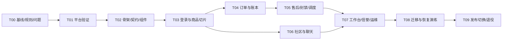

# 05 实施计划与模型交接

> 接续提示（2026-10-22）：任务卡是完整路线，不代表所有阶段已实现。先读 [实际交付与接续手册](./DELIVERY-HANDOFF.md) 和 [验证记录](./verification.md)，保留当前工作区；不要从 T00 重头开发，也不要因样板已能运行就跳过 T01 剩余门槛。

日期：2026-10-21｜起点：`release/2026-10-trial-hotfix@b2b6266`。本文件给实现者具体任务和完成标准。任务卡中的文件是预期落点，实际新 HEAD 有变更时先核对，不能覆盖他人修改。

实施更新：前端按用户确认采用 JavaScript + Vue 3 + Element Plus，使用中文 JSDoc 与 checkJs；后端继续 Python/FastAPI。原文中的 TypeScript 前端工具及示例据 [0004](./decisions/0004-javascript-element-plus.md) 调整，任务依赖和验收门槛继续适用。

## 1. 实施顺序与总约束



每阶段交付一个可运行版本，可以先在隔离环境运行，不要求每个中间切片都切到线上。交易、商品预留、封禁和 Cron 相互影响；旧写入如果不遵守新版本字段/约束，不能与新交易路径随机分流写同一库。

采用小步提交，建议一个任务分成 2–5 个有主题的提交；无硬性代码行数配额。规则修复、协议迁移和视觉改善独立标记，核心结构迁移不夹带新业务。计划先控制依赖与验收，工时由 T01/T03 的实测速度评估，不能给不了解规模的模型承诺“两天全部完成”。

## 2. 可执行任务卡

### T00：锁定新基线、行为和风险

依赖：无。输入：本计划、最新源码、需求/接口合同、发布记录。

改动位置：`docs/refactor/` 下新增行为清单、决策记录和验证记录；必要的最小测试 fixture 修正独立提交。

交付：

1. 重新核对 HEAD、未提交文件、适用 AGENTS、现有 worktree 和引用，更新分支矩阵；以当时最新确认提交建实施基线，保留本版品牌、社区和首页成果。
2. 在项目独立环境补齐锁定依赖，复跑当前 462 项及 10 个 Node 脚本。本轮解释器缺 PyMySQL 造成 3 failure/1 error，先确认环境后归因，不能把所有失败当重构引入。
3. 把 01 的业务矩阵改为可执行样例；锁定角色/利益冲突、商品释放、期限、信誉、服务费冲回、历史 API 类型和错误码。
4. 为 A01/A02/A04 建立最小失败用例，独立形成 BUG 修复任务。需要时先在当前架构修补已确认问题，再移植到目标；A03 认证随 T01/T03 协议迁移，不能降 KDF 轮数求通过。
5. 用临时合成数据建立当前首页/详情/发布/订单/聊天/工作台的基准截图，注明视口和角色；保留当前双轮播语义。

验收：固定提交能复现测试和关键页面；问题状态区分“复现/已修/平台未验”；没有未经核实的“全通过”或线上声明。回滚：删除本任务新增的合成测试/文档或 revert 对应小提交，不涉及真实数据。

建议提交主题：`docs(refactor): lock latest behavior baseline`；`test(trade): reproduce checkout atomicity and replay gaps`；媒体缺陷单独 `fix(media)`，不与目录搬移合并。

### T01：证明 Python/FastAPI + D1/R2 的运行路线

依赖：T00。改动位置：独立 `experiments/worker-poc/`、隔离配置与验证记录，不引用生产 binding ID，也不默认继承旧 remote:true。

验证项：

| 编号 | 必须验证 | 完成证据 |
| --- | --- | --- |
| P01 | FastAPI ASGI 请求、输入错误、统一错误、bindings 注入 | 最小请求与响应；本地/隔离平台环境分别标注 |
| P02 | D1 batch 约束失败、零行 UPDATE、事务内断言、FFI | 故意在末尾失败后所有表回到原值；不能只有 mock |
| P03 | 8/20 件下单参数与原子预留 | 单语句参数≤100，整体成功或整体失败，平台限额真实触达 |
| P04 | 旧 PBKDF2 向量/600000 轮、恢复码、耗时和包资源 | 维护中的可用实现与正确向量，记录 CPU/冷启动；不验证真实口令 |
| P05 | R2 图片、EXIF/WebP/最大输入、私密读取 | 峰值内存/CPU、正常图片及越权拒绝，失败孤立对象处理 |
| P06 | Cron 与 FastAPI 入口组合、重试/漏跑 | 重复/延迟事件仍正确；无法组合则验证共享包的薄定时入口 |
| P07 | Vue dist、API/media 排除 SPA fallback、Cookie | 深链刷新成功，API 404 JSON，静态请求不进入 Python |

本地验证先行；真实平台使用隔离测试资源，在实际资源访问获准后执行，本轮没有执行。若关键能力尚未通过，只阻塞其依赖任务；可继续离线规则提取、UI 样板和契约。失败必须给具体版本、输入和资源证据，之后按 02 的条件启用外部 FastAPI 备选，不能任意换数据库。

验收：主方案有可重复的证据，或有明确失败记录及备选决定。回滚：停止 PoC；已创建的测试资源按约定清理，生产资源不受影响。此阶段不得打开真实业务入口。

### T02：工程骨架、契约、组件和开发体验

依赖：T01 的可用路线。改动位置：`apps/api`、`apps/web`、`infra`、`contracts`、新工具配置、统一开发脚本。

交付：唯一组合根、领域目录的最小实现；D1 client/原子计划编译器/事务断言基础；版本化 migrations；错误封套与 request_id；Vue Router/Pinia/typed client；03 的 lint/format/typecheck；04 的 tokens 和基础组件样板。

先定义旧 API 与新 v1 DTO 转换，不把旧数组/数字 ID 原地改类型。建立 local/test/production 配置隔离，默认本地资源；真实配置不因缺变量自动回退演示。Windows 中文与空格路径一条说明可启动、检查和构建，锁文件入库。

为让以后新功能持续遵守规范，在实施时将已确定的短条款及本目录链接接入仓库根 `AGENTS.md` 和 PR/需求模板；若届时已有指令先合并其有效约束，不覆盖。这里只写架构、代码、界面和验证规则，不把设计文档转成生产操作授权。自动检查落实模块依赖、类型/格式和必要测试，视觉部分保留截图审查。本轮没有新增根指令文件。

验收：干净环境可按说明启动；`/health`、静态资源、错误和 API 深链测试通过；基础组件有正常/禁用/loading/错误/长文案/键盘样例；新代码格式和类型检查生效；模块依赖无环。回滚：旧入口继续可运行，删除骨架或 revert；尚不切写真实数据。

### T03：首个完整切片——登录、商品浏览、含图发布、详情

依赖：T02；旧凭据 KDF、R2 处理门槛已通过。新 API 的合成测试库包含旧格式凭据，**不导入真实凭据进入测试**。

逐项改动：

| 位置 | 具体产物 |
| --- | --- |
| `modules/identity` | 登录、会话/退出、当前身份、最小资料；恢复码/改密合同及后续入口保持 |
| `modules/catalog` | 分类 schema、SQL 分页列表/详情、含图发布、字段不丢失、版本保护 |
| `modules/media` + `infrastructure/r2` | 上传状态、角度/摘要/owner、读取授权、补偿记录 |
| D1 migrations/adapter | 兼容扩展、必要索引和媒体关联；合成旧库升级样例 |
| Web app/layouts/shared | 市场外壳、五槽导航、右上头像、基础状态组件和历史 hash 跳转 |
| Web identity/catalog features | 登录、首页、详情、发布；本地账号隔离草稿、追加流和收藏保位 |
| contracts/legacy adapter | 新旧 DTO 显式转换，已迁移动作只有一个业务写入口 |

端到端验收：旧算法合成账号登录 → 刷新/退出/切换账号 → 搜索/分类/下一页 → 上传本人三视图 → 发布各分类属性 → 详情照片与字段完整；重复图片、非 owner、无权媒体、低信誉、超界价格、断网重试均有明确结果。500/代理 HTML 不清会话，草稿/清单/迟到响应不串号。

视觉验收：按 04 的四尺寸截图和状态检查，保留当前品牌和核心首页交互；UI 改进单独提交，未批准的轮播改规则不混入 REF。新页所有 API 使用 typed client，禁止再拼 HTML 字符串/全局 action。

这一切片完成不等于订单、社区或后台已重构。回滚：隔离环境回到旧页面/入口；扩展 schema 保持向后兼容；清理仅限测试对象。生产切换必须等所有相互影响的写路径满足同一约束。

建议提交：工程接入 → identity 服务/合同 → catalog/media 后端 → Vue 页面 → 浏览器/视觉回归；高风险认证与媒体变更独立可审查。

### T04：订单、预留、改约与模拟账本

依赖：T03，02 的原子性与幂等设计。改动：trade 规则/用例/D1 原子写、order_items/预留关系/版本迁移、清单和订单页面、兼容接口。

交付：下单、付款前修改、付款、卖家交付、买家交接/收货、双方改约；同卖家最高送货费；快照、求购匹配/5% 费用；未知结果原键恢复；关键查询分页。

验收：并发抢单一个成功；20 件整体失败无残留；价格/报价金额/卖家/求购变化拒绝；同键同内容一次、异内容包括 want_id 拒绝；修改订单不改变原请求摘要；金额和模拟账本守恒。至少隔离真实 D1 验证一次全部事务场景。

回滚：未切换生产可直接撤回；已写生产时只回到兼容同 schema、同预留语义的版本，不能切回忽略 reserved_order_id/version 的旧交易写入。重大故障冻结交易写入并对账后处理，不随机 fallback 到旧端点。

### T05：工单退款、账号处置与定时任务

依赖：T04。改动：support、跨域工作流、identity/staff 处置边界、Cron 作业和工单/售后页面。

交付：认领/公开回复/内部备注/处理/复核；结算前后全额与部分退款、冲回；封禁/注销/清除及关联订单释放；到期取消/退款/自动收货；通知与审计同 batch。

验收：自己或相关参与者不能处理案件；退款不复活商品；封禁卖家取消后仍不在售；工单/订单/账本/求购/通知任一失败整体回滚；重复 Cron 和用户竞争不重复财务事件；超时从正确时间字段起算；停机补跑正确。规则分歧在此阶段之前逐项确认。

回滚：先停相关写入口/任务并核对幂等与账本；只回到已知兼容版本。财务事件不靠删流水撤销，使用审计可追踪的纠正方案。

### T06：社区、论坛、求购、好友和聊天

依赖：identity/契约和社区规则锁定，可在 T04 后续工作期间按独立文件推进。改动：community 子模块、消息契约、变更游标、Vue 页面和小程序兼容。

交付：保留新版社区/论坛入口、帖子评论回复、求购、好友申请短附言/同意/拉黑、群与分流/群角色、客服会话、撤回/隐藏/移除、消息 outbox 与重试去重、正确已读/未读。

验收：陌生人不能普通私聊，好友同意后可发；客服豁免按上下文；重发同 key 只一条；并发消息/分页不重不漏；旧消息撤回能增量同步；隐藏窗口停高频刷新；账号切换无私密内容残留；好友和消息迁移前后关系一致。普通轮询通过后才讨论 SSE/WebSocket/DO。

回滚：兼容消息/好友表和游标，不能删除已保存消息或重置所有未读。回滚后不认识的变更事件需有适配，不能让撤回内容重新展示。

### T07：工作台、信誉、审核、通知与运维

依赖：T05/T06 的服务合同。改动：staff/reputation/moderation/notifications/ops、WorkspaceLayout 及页面。

交付：人员等级管理、档案/审计访问边界、工单与商品/内容治理、信誉处罚/好评/标签、词库维护、站内提醒/角标；分页与导出、对账、受控备份作业和恢复说明。

验收：四级角色、归属/利益冲突、最后开发者保护；举报不直接扣分，核实工单处罚防重复；内部命中词不公开；工作台查询有界且无 N+1；备份新增表自动纳入或明确拒绝不完整备份；小屏可使用，危险处置有后果说明。

回滚：角色/审计不回写旧错误状态，恢复到兼容版本；备份任务可暂停，已存在备份仍可解读。通知服务不能反向依赖聊天服务。

### T08：迁移、兼容与恢复演练

依赖：核心模块实现且合同稳定。改动：只读盘点/导出/导入/校验脚本、迁移记录、恢复 runbook；此时先针对隔离副本。

交付和验收按 §3；至少完成一次旧 schema → 新 schema → 业务回归 → 备份 → 隔离恢复 → 对账，保留去标识结果和失败重跑记录。验证旧 Web/hash、原生小程序和脚本的兼容/退役安排；不能因 Web 改完就删原生客户端。

回滚：迁移脚本支持明确 checkpoint，恢复演练不覆盖权威库；真实切换前仍可停止。任何无法解释的账本、主键或媒体差异都阻塞切换。

### T09：发布、单一写路径与退役

依赖：T08 全部通过；形成具体可审阅发布包、迁移/备份/回退方案后进入发布授权阶段。发布操作不由本文自动授权。

交付：从干净已验证 SHA 构建；记录包摘要、schema 版本、Cloudflare Version ID、环境与实际页面/API 核验；同步本地/GitHub/部署的真实关系。切换前冻结受影响写入并处理在途任务/上传，切换后对账。

旧写入入口退为显式 adapter 或关闭；所有未迁移消费者有版本记录。观察期结束后，再删旧 Market/手工路由/重复规则/旧 CSS 和无用依赖，更新启动和目录文档。退役拆为独立提交，不把清理和首次上线绑成一件事。

回滚：按 §3 区分代码回滚与数据恢复；未完成兼容验证不能回到最初 master。发布故障不能通过空库重绑或清空用户数据恢复服务。

## 3. 数据迁移与回滚操作设计

### 3.1 先找到权威数据

实施时先做只读盘点：部署 SHA/Version ID、D1 名称/绑定/现有 schema/迁移记录、表计数/关键摘要、R2 引用和缺失对象；核实仍在使用的 SQLite/MySQL。业务负责人确认哪份是权威写源，其他来源保留为历史副本，不能把多个库直接按最大时间戳拼起来。

盘点报告只保存 schema、计数、摘要和合成/脱敏样例。备份含凭据和私密媒体，应存于受控位置；不在 Git、公有下载或静态目录。不在本轮执行这一步的真实资源访问。

### 3.2 扩展、回填、验证、切换

| 步骤 | 行为 | 必须校验 |
| --- | --- | --- |
| 备份 | 数据库一致导出 + 媒体 manifest + checksum/版本 | 能在独立环境恢复，不只有“导出成功” |
| 建基线 | 比对实际 schema 与仓库迁移，登记已有结构 | 不重复 ALTER、不重建现用库 |
| 扩展 | 增加表/可空列/索引，旧读写仍兼容 | 升级前后旧合同可运行 |
| 回填 | 按稳定主键游标分块，保存来源版本、计数、checkpoint | 重跑不重复插入、不重编号；错误明确停止 |
| 对账 | 账号关联、订单快照/状态、账本汇总、好友/消息、媒体引用 | 精确规则下计数/金额/摘要一致；可解释排除项 |
| 切换演练 | 单一 writer，旧消费者走显式 adapter | 不出现旧 writer 绕过 version 或新媒体权限 |
| 观察 | 错误、冲突、未知结果、队列与余额持续核对 | 新写入可追踪，回退版本已验证 |
| 收尾 | 观察期后才删旧字段/代码 | 回滚窗口、资料留存与备份版本明确 |

存在 SQLite/MySQL 数据时用显式导出映射导入隔离 D1，记录主键和时间/布尔/JSON/NULL 语义；不是长期保留三套主数据库。账号凭据保留并验证合成向量；恢复码不重新生成后把用户原码作废。历史会话是否撤销属于切换决定，要让客户端正确重新登录。

订单明细结构化回填仍保留原 JSON 快照和版本。旧下架原因无法可靠推断时登记 `legacy_unknown` 并采用保守恢复权限，不能凭猜测把它变成卖家自主下架。无法唯一确定的预留归属先列冲突，不任意选一个订单占有商品。

### 3.3 回滚边界

代码回滚只适用于 schema/语义仍兼容的旧版本。数据库恢复会撤销恢复点后的写入，需要先停写、保留增量、明确重放/人工对账策略；`git revert` 不会恢复数据。D1 Time Travel 只覆盖数据库，R2 要按对应 manifest 恢复/核验。

禁止在用户继续写入时把旧快照直接覆盖现库。破坏性收缩 schema 留到观察期后，优先前向修复。恢复演练使用隔离目标，不把创建空目标等同“用空库替换真实库”。

## 4. 测试与发布验收矩阵

| 层级 | 覆盖内容 | 不能代表什么 |
| --- | --- | --- |
| L1 纯规则单元 | 金额、权限、状态/时钟、信誉、请求规范化 | 不证明 D1/FFI |
| L2 合同与 SQLite 模拟 | 旧 API DTO、新 OpenAPI、业务事务计划和失败注入 | 不证明参数上限、Worker 资源或 R2 |
| L3 本地 Worker + D1/R2 | 实际 binding/FFI、路由、包加载、迁移 | 不完全证明真实平台资源与行为 |
| L4 隔离真实平台 | SQL 限制、并发/回滚、KDF/图片资源、缓存/鉴权、Cron | 不等于生产数据迁移已经通过 |
| L5 Vue/浏览器 | 用户交互、账号隔离、状态、响应式、键盘/视觉 | 不等于原生微信真机 |
| L6 迁移恢复/小程序 | 对账、引用、恢复、原生编译/真机 | 不可由 JS 语法或 mock 代替 |

核心场景必须可追踪到测试：旧账号登录；三视图发布；8/20 件下单；两买家并发只一成功；多商品任一失败全回滚；同键同/异内容；提交成功但响应丢失；付款/交付/交接/收货；用户与 Cron 竞争；结算前后部分退款冲回；封禁后库存不复活；求购匹配不串；好友聊天同键重发无重复；旧消息撤回；第三人/无关客服媒体拒绝；内部备注保护；迁移恢复前后对账一致。

保留旧 Market 测试的业务输入/输出，把 fixture 改为显式服务或兼容 facade；不重写断言来迎合新代码。旧 ES 模块测试在退役前继续运行；Vue 组件和浏览器另建测试，不能用模块可加载代替操作成功。

测试数据构造不使用生产账号；并发测试用同步屏障/确定的版本竞争，避免靠 sleep 碰运气。Windows 含中文/空格目录测试独立列出；小程序若没有工具/AppID/真机，应明确该层未验，不能宣称全部客户端完成。

## 5. 性能、费用与维护验收

以相同数据规模和环境比较：商品 24 件列表目标不超过 4 次业务查询，订单分页附属数据按组读取，不能每项 N+1。20 件 checkout 优先集合 SQL 编译，统计整个请求含认证/预读/提交的语句数，目标留在所选套餐限额内并有余量；不能只统计一次 batch 的网络调用次数。

建立合成 1 万商品、10 万消息的查询样例，记录 EXPLAIN、rows_read/rows_written、请求/CPU/内存、包与冷启动；规模用于发现扫描问题，不宣称真实线上已有相同数量。普通路径的初步预算可设受控环境 warm GET p95≤800ms、写请求 p95≤1500ms，T01 依据测量调整并记录；这不是对实际校园网络的 SLA。

成本表记录：Worker 调用/CPU、D1 扫描/写行/库容量、R2 存储/操作、轮询频率、备份占用、日志量。套餐价格在购买决策时重新查官方信息，不假设免费计划能承载 600000 轮 KDF/最大图片，不在设计阶段自动启用付费。首先优化查询与轮询，不先加 Redis 或第二个数据库。

维护标准：一个人能按文档启动、找到所属模块、运行相关检查、定位 request_id、回滚兼容版本；新增功能不需要修改巨型路由/全局事件表/Market 继承列表。完成至少一个独立新增小功能演练，检查它能否只扩展所属领域、契约和共享组件，而不再次引入全局耦合。

## 6. 模型接手提示词

把以下文本连同整个仓库和 `docs/refactor/` 交给实现模型。每轮替换任务编号，建议从 T00 开始；无需依赖本聊天的口头上下文。

```text
你接手“华立转角”的重构实现。本轮任务是【T00 或明确的子任务编号】。

先读取 docs/refactor/README.md，以及 01–05 中与任务相关章节。
用户已要求重新设计为容易维护的架构，并要求新增功能遵守同一代码与界面标准。
核对当前 HEAD、适用 AGENTS 和未提交文件；文档基线为 b2b6266，若已更新，先比较差异。

按 02 的模块边界和 D1 原子性设计实现，按 03 编码，按 04 验收视觉与交互。
以当前最新 hotfix 为起点，保留社区/论坛、双专题、五槽导航、紫色 ZJ 和已有业务。
历史 refactor 分支只按语义复用，不整体替换。按真实源码核对，禁止补造已存在文件或测试结果。

先写本任务的改动清单与验收场景，然后实施一个可运行的小切片。
标记 REF/BUG/RULE/FEATURE；业务规则与体验变更不要混在纯结构迁移中。
账号/订单/账本/消息/审计/媒体和原生小程序不能丢失；支付仍为模拟。
禁止新增 Market mixin、全局事件表、第二套订单规则或伪 D1 事务。
交易中所有关键写入与通知/审计原子提交，幂等异内容必须拒绝。
所有新页面复用布局、tokens 和基础组件，覆盖加载/内容/空/错误/无权/提交状态。

测试使用隔离合成数据。真实数据库修改、推送、部署、切流量和收费资源不由设计文档授权；
先完成本地实现、测试、迁移/回退方案，形成可审阅结果后再进入实际操作阶段。
不要拿当前 remote:true 配置直接运行开发测试；不要覆盖他人文件或清空数据。

交付报告：任务编号；具体结果；变更文件；模块依赖是否符合设计；
API/数据/权限兼容；实际测试命令/环境/结果；需要的截图；
尚未验证的能力、回滚边界与下一任务。未完成项如实列出，不能用通过 mock 冒充真实平台验收。
```

若以后交给多个实现模型，先约定文件所有权和契约，再分独立任务；共享 schema、认证、tokens 和组件由一个整合者负责。跨目录修改先协商，不同时改同一工作区。模型可以报告建议，不自行改架构路线或业务政策来缩短任务。这个约定描述未来协作方式，本轮没有启动其他模型实施。

## 7. 三类尚待核实项及阻塞范围

| 待核实项 | 只阻塞哪些动作 | 现在可以继续什么 |
| --- | --- | --- |
| 线上 SHA、权威 D1/R2、schema、现用客户端、可恢复备份 | 真实数据迁移与生产切换 | 全部离线审计/规则/骨架/UI/合成测试 |
| KDF/图片/ASGI/Cron 的真实平台资源和行为 | 依赖该能力的最终运行位置与发布 | 隔离 PoC、无平台依赖规则、契约与组件 |
| 会话续期、恢复上架、档案范围、开发者同级操作、封禁申诉、部分退款费用冲回的分歧 | 相应模块的行为变更上线 | 先保留当前语义与测试，推进其他模块 |

这些项目在执行到相关边界前核实，无需为了编写计划反复提问。技术路线由本计划给出主方案和条件备选；业务政策分歧不能由实现模型自行决定。
