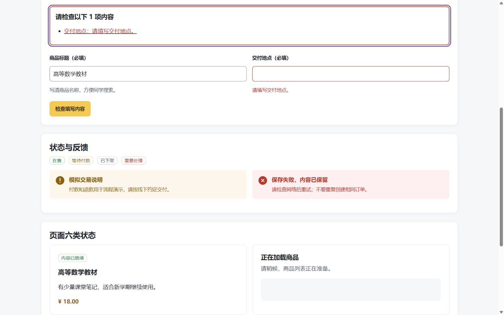
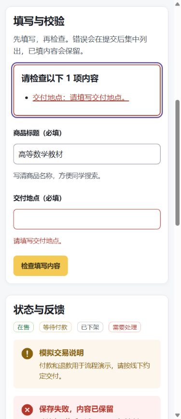

# 华立转角重构：本批交付与接续手册

原交付日期：2026-10-22（北京时间，跨越 10 月 21 日晚间开发）；最新增量：2026-10-23 首页方案应用。

**这份手册描述实际交付，不把设计目标当作已完成功能。** 面向项目所有者、下一位开发者和接手 AI；仅凭仓库文件即可定位实现、启动、验证和继续工作。

> **2026-10-22 换机接手：** 当前工作目录为 `C:\Users\7M\Desktop\前端\huali-corner-refactor`，从 GitHub 核对并拉取 `release/2026-10-trial-hotfix@e611c31084aae51f46b5fe94ff1802d0736eb50b`，开始时工作区干净。旁边旧的 `huali-corner-trial` 有用户修改，未切分支或覆盖。本轮只推进环境复现与 T01 图片运行时依赖核对；新增结果见 [验证记录末尾](./verification.md#2026-10-22-换机接手环境复现切片)，不覆盖下文的历史证据。

**2026-10-23 当前增量：** 用户随后授权先写 T03–T07 的前端并交另一台电脑联调。本地已新增按领域拆分的业务页面、旧协议适配、路由和响应式样式；业务仍由原后端承载。当前改动未提交/推送，不能用 GitHub 的 e611c31 获取本轮未提交源码。完整启动与测试清单见 [前端候选换机手册](./FRONTEND-TRIAL-HANDOFF.md)。下文原 10 月 22 日的浏览器/Worker/提交记录是历史证据，不代表本轮业务页已验收。

## 1. 三分钟了解现在的状态

| 项目 | 实际状态 |
| --- | --- |
| 当前项目目录 | `C:\Users\7M\Desktop\前端\huali-corner-refactor` |
| 当前分支 | `release/2026-10-trial-hotfix` |
| 当前 Git 基线 | `e611c31084aae51f46b5fe94ff1802d0736eb50b`，本轮修改尚未提交；b2b6266 仅为重构前基线 |
| 本批成果保存在哪里 | 按用户随后授权，通过 GitHub 的 `release/2026-10-trial-hotfix` 分支交付；最新提交用 `git log -1` 核对，`b2b6266` 仅为实施前基线 |
| 最新技术选型 | 手写前端 **JavaScript + Vue 3 + Element Plus**；后端 **Python/FastAPI** |
| 注释要求 | 新增和重构涉及的函数、方法、测试、任务脚本都有中文用途说明；关键权限、事务、异步恢复写清原因 |
| 可直接预览 | trial 业务前端候选；首页方案经用户确认后已应用，保留组件样板独立入口 |
| 可运行的新 API | 健康检查、统一协议/错误边界、独立图片与原子计划基础；**业务尚未装配** |
| 旧业务处理 | 修补下单参数/幂等、媒体权限及旧客户端认证图片兼容，保留旧接口和原生小程序 |
| 尚未完成 | 全部业务真实联调、新后端领域迁移、真实平台验收、数据迁移与上线 |
| 本轮完成位置 | 首页、商品卡片及导航方案已应用；前端 38 项通过，后续按独立切片处理发布/订单/聊天体验 |

不要仅 checkout 基线 `b2b6266` 就以为拿到了本批代码。接手时获取该分支的最新交付提交，并检查本地是否还有其他未提交修改；保留任何后续工作区成果。不要执行 `git reset --hard`、`git clean` 或覆盖用户原有六份设计文档。

## 2. 用户已经确认的约束

1. 从本目录 README 及 01–05 六份文件出发重构整个项目，保留业务数据、账号、模拟交易、社区/论坛和原生小程序。
2. 前端选型已从原计划中的 TypeScript 改为 JavaScript + Vue 3 + Element Plus；后端继续 Python/FastAPI。生成的 `.d.ts` 只用于 JSDoc/checkJs 和编辑器提示。
3. 所有任务和方法加中文注释，让初学者能阅读。根目录 `AGENTS.md` 已落地这些要求。
4. 权威数据库暂不确定，要考虑兼容与扩展性。过渡期保留 SQLite/MySQL/D1 原路径；新增业务不能复制成多套独立 writer，更不能自动合并多库数据。
5. 保留紫色 ZJ、暖黄操作色、中文系统字体、紧凑双专题、五槽手机导航。新增 skill 的通用配色不覆盖品牌规范。
6. 用户最后要求：先完成正在开发的内容，出具交付手册，后续工作下次继续。没有安排定时任务或自动明日续跑。

## 3. 交付组成与代码定位

以下路径均相对于项目根目录。完整改动路径清单见 [DELIVERY-FILES.txt](./DELIVERY-FILES.txt)。

### 3.1 旧下单缺陷：A01 / A02

| 文件 | 修改内容与原因 |
| --- | --- |
| `Backend mission/app/cloudflare/trade_api.py` | 下单守卫用单个 JSON 快照与 `json_each` 核对 1–20 件商品，减少绑定参数；核对商品、卖家、价格、交付方式、求购和接受报价的原始快照。幂等键关联不可变请求摘要，订单后来修改或预约时间已过仍能恢复原请求结果，异内容重放拒绝。未知提交结果的恢复路径也核对请求身份。 |
| `Backend mission/app/cloudflare/schema.sql` | 新库的订单加入可空 `request_hash`。 |
| `infra/d1/migrations/0001_add_checkout_request_hash.sql` | 现有库的加法迁移，**没有应用到真实数据库**。 |
| `tests/test_cloudflare_trade.py`、`tests/test_checkout_migration.py` | 覆盖 20 件预算、求购不同、订单修改后重放、过期预约恢复、未知结果、旧库/新库迁移样例。 |

旧订单没有摘要时只能按旧字段保守比较，无法凭空还原修改前的原始请求。详见 [决策 0001](./decisions/0001-checkout-request-identity.md)。

### 3.2 媒体权限与旧客户端兼容：A04

| 文件 | 修改内容与原因 |
| --- | --- |
| `Backend mission/app/cloudflare/media_authorization.py` | 精确核对上传引用、资源归属、商品状态、订单参与人和工单上下文；角色名称不能直接绕过权限。 |
| `Backend mission/app/cloudflare/api.py` | 媒体入口调用资源授权；动态图片使用 `private, no-store`，避免私密图片被共享缓存。 |
| `web 7M/src/core/authenticated-media.js` | 旧 Web 的 `` 无法发送 Bearer，因此在严格同源媒体路径加载失败时带认证读取 Blob；不把令牌放进 URL，不向第三方发认证头。 |
| `web 7M/src/main.js`、`core/state.js`、`router.js`、`auth/login.js` | 安装兼容器；换页/换账号时取消请求、阻止旧图迟到、回收 Blob URL。 |
| `web 7M/miniprogram/app.js` | 私密媒体通过 `wx.downloadFile` 携带 Bearer；登记临时文件，拒绝旧会话结果并清理文件。 |
| `web 7M/miniprogram/pages/detail/index.js`、`index.wxml` | 详情接入认证图片；隐藏/卸载清空私密内容，迟到请求不能重新填入；无权图片显示失败说明，保留收藏、报价、清单、私聊、分享的原接口。详情文件拆开排版并补中文方法注释。 |
| `tests/test_cloudflare_media.py`、`tests/test_cloudflare_catalog.py`、`tests/private_media.test.mjs` | 验证服务端授权、Web Blob 兼容及小程序真实页面生命周期代码；微信平台边界使用合成响应，不是真机验收。 |

权限摘要：在售且卖家正常的商品图可公开；上传者可预览自己的图；历史订单图只对合法参与者开放；凭证仅本人，或带具体 `ticket_id`、已认领且无利益冲突的处理员工。详细条件见 [决策 0003](./decisions/0003-resource-media-authorization.md)。

**微信接入限制：** 部署时还需核对微信后台的 downloadFile 合法域名、实际临时文件行为及真机权限；本机没有执行微信开发者工具编译或真机检查。临时文件不保存到相册或持久业务缓存。

### 3.3 新 Python/FastAPI 工程基础

| 目录/文件 | 已实现职责 |
| --- | --- |
| `apps/api/src/huali/bootstrap.py` | 唯一组合根 `create_app`，集中装配，不在业务模块随意创建应用。 |
| `shared/settings.py` | 必须显式提供 `HUALI_ENV=local/test/production`，缺失拒绝启动，不自动选空库。 |
| `transport/` | v1 封套、校验/业务/HTTP/未知错误映射、服务端 request_id、禁止缓存；内部异常细节不回给用户。 |
| `infrastructure/d1/atomic.py` | 检查绑定参数与 SQL 字节预算；期望影响行数在同一个 batch 内通过命名 CHECK 约束断言，避免伪事务与检查后竞态。 |
| `infra/d1/migrations/0002_create_atomic_assertions.sql` | 新适配器所需断言表；**未用于真实库**。 |
| `infrastructure/images/normalize.py` | 真格式白名单、字节/像素限制、静态图片、EXIF 方向、清除元数据、WebP 输出及摘要；头像最大 512 边，商品最大 1600 边。 |
| `apps/api/tests/` | HTTP 协议、原子失败注入、依赖边界和图片行为共 17 项。 |
| `apps/api/scripts/export_contract.py` | 从实际模型导出 `contracts/openapi.json`；目前仅健康接口。 |

新 API 的 `/health`、`/api/v1/health` 返回 `business_ready=false`。**它没有登录、商品、订单等业务路由，没有新 writer，也没有接入生产数据库。** 不要将健康接口成功等同于业务重构完成。

### 3.4 新 JavaScript / Vue 3 / Element Plus 前端

| 目录/文件 | 已实现内容 |
| --- | --- |
| `apps/web/src/app/` | 应用、路由、开发组件样板、默认未开放页面。默认生产构建不开放 `/_dev/components`；开发或显式 preview 模式开放。 |
| `shared/design-tokens/tokens.css` | 从 04 落地品牌/语义色、字体、间距、圆角、层级和动效令牌。 |
| `shared/ui/` | Element Plus 适配按钮、弹窗、输入字段、状态标签、持久提示、页面六类状态、可聚焦的表单错误汇总。 |
| `ComponentGalleryPage.vue` | 可实际提交的本地表单：提交后校验，聚焦错误汇总，通过链接定位字段；保留输入；修正后明确提示“尚未发布商品”，继续编辑撤销旧通过结果。 |
| `shared/http/client.js` | 同源 v1 请求、封套与 DTO 校验、CSRF/幂等头、Retry-After、未知写入结果处理；服务端 5xx 不自动清登录。 |
| `shared/http/request-scope.js` | 页面/账号变化时取消请求，忽略迟到响应。 |
| `shared/http/generated.d.ts` | OpenAPI 生成工具提示类型；不是手写 TypeScript 业务。 |
| `eslint-rules.js`、`jsconfig.json` | 中文具名方法注释检查、严格 checkJs 与 Vue 模板检查。 |

已使用新装 `ui-ux-pro-max` 优化表单反馈、焦点、触控目标、响应式和可读性；按 `tdd` 在用户确认的前端入口完成两个失败→实现→通过循环。具体查询、取舍及架构 skill 缺失依赖见 [skill-usage.md](./skill-usage.md)。

**还没有新的业务首页、完整五槽导航、登录、真实商品发布或新旧 hash 路由桥接。** 组件预览不能当作整站新前端交付；样板输入不发送商品写入请求。

### 3.5 本地 Worker 探针与协作工具

- `experiments/worker-poc/`：独立名称、`remote:false` 的 D1/R2、本地 ASGI/Cron/静态路由、回滚、20 行 JSON batch、旧 KDF、R2 和图片探针。探针接口仅供本地合成能力验证，缺少正式业务认证，禁止直接部署。
- `scripts/refactor.ps1`：Setup / Check / Contracts / Api / Web 五种任务，遇到工具失败停止，支持中文/空格路径。
- `.github/workflows/refactor-checks.yml`：新工程检查、协议漂移、旧后端回归和所有 `.test.mjs` / `.test.js` 客户端脚本；**尚未推送或在 GitHub 执行**。
- `.github/pull_request_template.md`、根 `AGENTS.md`、决策 0001–0005：落地增量开发和交付规则。
- `tests/user_center.test.mjs`：修正 Windows 中文路径 URL 解码，不改变业务断言。
- `.gitignore`：排除依赖、缓存、运行产物、PoC 同步副本等；不能把整个虚拟环境提交进仓库。

## 4. 进度：按任务门槛说明，不使用虚假的完成百分比

| 原计划任务 | 本批进度 | 剩余门槛 |
| --- | --- | --- |
| T00 基线与问题 | 已核对分支与工作区、补依赖、跑旧回归、修 A01/A02/A04 | 旧首页/详情/发布/订单/聊天/工作台的角色与视口截图基线不完整；行为矩阵还未全部变为可执行样例。 |
| T01 平台路线 | 多项本地 Worker 能力已实测；图片算法与打包差异已有证据 | 真实隔离平台 CPU/内存/冷启动、D1 并发与完整业务事务、Cookie/CSRF、Cron 补偿等未验收；见下一节的版本及 TLS 限制。 |
| T02 工程基础 | 新 API、Vue/Element Plus、工具、契约、基础原子/图片适配器、组件预览已落地 | 正式 Worker 组合根、真正 D1 FFI 接入、旧新业务 DTO mapper 与领域服务仍待完成。 |
| T03 登录—首页—含图发布—详情 | **前端候选已写；完整切片未验收** | 已有 Vue 业务页面、旧认证与上传适配；新后端领域迁移、Cookie/CSRF、平台和浏览器业务验收仍未完成。 |
| T04–T07 订单/售后/社区聊天/工作台 | **前端候选已写；后端仍由旧实现承载** | 已有清单/订单/工单/社区/好友聊天/分权工作台页面；事务、Cron、增量游标、性能和真实联调不因前端构建而完成。 |
| T08 数据迁移与恢复 | 未执行 | 权威写源未确认，未连接真实资源，未做隔离副本迁移/恢复/对账。 |
| T09 发布与退役 | 未执行 | 未部署、未切流量、未关闭旧 writer、未退役旧代码。 |

## 5. 验证结果、失败记录及其边界

| 验证 | 实际结果 | 范围与限制 |
| --- | --- | --- |
| 旧 Python 完整回归 | 本轮早些时候 **480 项通过，约 149 秒** | Python 3.12.14 + Pillow 12.3.0 + PyMySQL 1.2.3；之后的收尾改动是客户端兼容与新工程，没有重新声称跑过另一轮 480 项。 |
| 旧客户端脚本 | 收尾重新运行 **11/11 脚本通过** | 包括三个原生 `.test.js` 及新媒体兼容脚本；合成平台边界不是真机。 |
| 新 API | **17 项通过** | Ruff 检查/格式与严格 mypy 通过；故障注入的 request_failed 日志是预期场景。Starlette 对 httpx 有弃用提示，未影响结果。 |
| 新前端 | **11 项通过** | ESLint/Prettier、checkJs/Vue 模板检查、默认生产构建通过。两个页面表单测试通过可见 DOM 和焦点断言，不读取内部状态。 |
| 预览构建与契约生成 | **收尾通过** | 显式 preview 构建包含样板，随后重新默认构建恢复关闭开发路由的产物；重新生成 OpenAPI/声明后，两文件 SHA256 与生成前一致。 |
| 实际浏览器 | 表单错误汇总、Tab/Enter 定位、修正后反馈；弹窗打开/Escape/焦点返回 | 320/390/768/1440 目标宽度无页面横向溢出；不是旧全站的视觉基线。 |
| 本地 Worker 基础探针 | 本轮曾实际通过 | ASGI、后续 CHECK 失败整体回滚、20 行 JSON batch、R2、重复本地 Cron、API/media JSON 404、SPA 深链、600000 轮合成旧 KDF 向量。 |
| 本地 Worker 图片探针 | 本轮曾实际通过 | Pillow 12.2.0，JPEG/PNG/WebP、EXIF、头像缩放、20M 合成像素、5 MiB 填充 JPEG、超限/截断/动画拒绝、R2 回读。不是云端资源预算或任意照片压力证明。 |
| Worker 收尾重启复核 | **未通过，单独保留失败** | 同步源码触发重载后，workerd 报 `kj/compat/tls.c++:429 ... peer disconnected without gracefully ending TLS session`；图片请求连接被重置。停止旧实例并用同一隔离配置重启一次，仍在启动阶段遇到 TLS 错误。不能把此前通过写成“最终环境可稳定复现”。 |
| GitHub CI、微信真机、隔离云端与生产 | 本地交付收尾时未执行 | 推送会触发新 CI，具体结果查看 GitHub Actions；没有据此作全部验收或上线声明。 |

### 图片运行时的明确限制

新 API 锁 Pillow **12.3.0**；当前 Worker SDK 兼容索引仅为探针解析到 **12.2.0**。后者缺少 12.3.0 的部分安全修复。**只允许本地合成能力验证，不能据此直接采用 12.2.0 接真实上传。** 详见 [决策 0005](./decisions/0005-worker-image-runtime.md)。

KDF 内部计时约 0.98–0.99 秒、20M 合成图片约 0.72 秒，都是早前本机墙钟观测，不是云端 CPU 计费、峰值内存、并发或 SLA。不要为满足预算降低旧 KDF 的 600000 轮数。

## 6. 拿到项目后如何启动和验收

### 6.1 先核对交付提交与本地修改

```powershell
# 任务：核对接手位置、最新交付提交与本地修改；以下均在项目根目录执行。
Set-Location 'C:\Users\90442\Desktop\前端学习\huali-corner'
git branch --show-current
git rev-parse HEAD
git log -1 --oneline
git status --short
```

新工程与文档是本批新增目录，已纳入本批交付提交；`DELIVERY-FILES.txt` 的 M/?? 是提交前快照，不能当作当前状态。若接手时仍有未跟踪文件，先核对来源，不直接删除。先阅读根 `AGENTS.md`，再读本手册、`verification.md`、决策及相关 01–05 章节。

### 6.2 安装及检查新工程

需要 Node.js 22.12+、Python 3.13/3.14 和 uv 0.13.4。本机已使用 Node 24.21.0、新 API Python 3.13.16；旧业务回归另用 Python 3.12.14。新旧虚拟环境不要混用。

```powershell
# 任务：使用锁文件准备新工程；需下载公开依赖，已安装时不必重复执行。
powershell -ExecutionPolicy Bypass -File .\scripts\refactor.ps1 -Task Setup

# 任务：新 API 的 Ruff/mypy/17 项测试，以及前端格式/类型/11 项测试/构建。
powershell -ExecutionPolicy Bypass -File .\scripts\refactor.ps1 -Task Check

# 任务：从实际后端模型更新 OpenAPI 与前端生成声明；不是手写业务类型。
powershell -ExecutionPolicy Bypass -File .\scripts\refactor.ps1 -Task Contracts
```

Setup 可回退使用项目忽略目录 `.local-deps/bin/uv.exe`；这些本机依赖不随 Git 移交，换机器需要安装 uv。`PYTHONUTF8=1` 由任务入口设置，避免中文路径编码问题。

已有 Python 3.13/3.14 时可显式复用，例如本机已验证的 Conda Python **3.13.12**：

```powershell
# 任务：复用已有解释器建立项目独立依赖环境；此选项禁止 uv 下载其他 Python。
# 前提：uv 和符合要求的 Node/npm 已在 PATH 中；本机 Python 路径以实际检查为准。
powershell -ExecutionPolicy Bypass -File .\scripts\refactor.ps1 -Task Setup -PythonExecutable 'D:\developTools\python.exe'
```

路径不存在会在调用安装工具前停止；版本不符合 `apps/api/pyproject.toml` 时由 uv 拒绝，不放宽工程版本要求。该参数只选择新 API 的宿主解释器，**不能替代 Worker SDK 按兼容日期选择的构建解释器/Pyodide**。本机锁定 SDK 在 `compatibility_date=2026-10-21` 下选择 CPython 3.14 和 Pyodide 3.14.2；Worker 同步另要求 uv 至少 0.12.3，交付推荐仍为 0.13.4。

新前端在 `.gitattributes` 固定为 LF。Windows 的全局 `core.autocrlf=true` 曾使新检出目录 29 个文件的 Prettier 检查失败；仅恢复 LF 后，格式、类型、11 项测试及默认构建通过，前端业务源码没有内容差异。

### 6.3 查看前端样板和新 API

```powershell
# 任务：在终端一启动新 API，仅监听 127.0.0.1:8001，不连接真实业务库。
powershell -ExecutionPolicy Bypass -File .\scripts\refactor.ps1 -Task Api

# 任务：在终端二启动组件样板；5173 被占用时明确选择 5186。
npm --prefix apps/web run dev -- --port 5186
```

访问 `http://127.0.0.1:5186/_dev/components`；API 查看 `http://127.0.0.1:8001/api/v1/health`。开发预览和正式构建的路由开关不同，默认 `npm run build` 只开放未就绪说明页。`npm --prefix apps/web run build:preview` 是显式预览构建，不能替代正式业务发布包。

人工验收步骤：

1. 保留预填标题、交付地点留空，点击“检查填写内容”；焦点应到错误汇总，标题不能丢。
2. 按 Tab 再按 Enter 激活错误链接；焦点应到交付地点。
3. 填公共交付地点再次检查；显示“填写检查通过”和“尚未发布商品”，错误清除。
4. 继续编辑；旧通过提示应撤销。两个字段留空时，汇总应有两项。
5. 点击“发布商品”样板按钮；弹窗出现，Escape 关闭，焦点回到按钮。此处不会创建真实商品。
6. 用 320/390/768/1440 宽度检查长文案、错误状态和无横向溢出。

### 6.4 旧客户端脚本与旧后端回归

```powershell
# 任务：执行全部旧 Web/原生客户端脚本，任一失败即停止。
$clientScripts = @(Get-ChildItem tests -File | Where-Object { $_.Name -match '\.test\.(mjs|js)$' })
foreach ($clientScript in $clientScripts) {
    node $clientScript.FullName
    if ($LASTEXITCODE -ne 0) { throw "客户端验证失败：$($clientScript.Name)" }
}

# 任务：用独立旧环境执行完整业务回归；不覆盖 apps/api 的虚拟环境。
uv run --no-project --python 3.12 --with Pillow==12.3.0 --with PyMySQL==1.2.3 python -B -X utf8 -m unittest discover -s tests -p 'test_*.py'
```

### 6.5 本地 Worker 探针

完整命令见 [探针 README](../../experiments/worker-poc/README.md)，先设置 `PYTHONUTF8=1`，从该目录 `uv sync --locked`、`npm ci`，运行 `sync_sources.py`，初始化**隔离本地** schema，再 `uv run pywrangler dev --test-scheduled`，另一个终端运行 `image_smoke.py` 和 `smoke.py`。

启动时必须看到 DB、MEDIA、ASSETS 为 local；若再遇到本手册记录的 TLS 启动错误，保留失败与版本信息后排查运行时下载/网络，不改变业务 SQL 或安全参数来掩盖启动故障。**不要用 `Backend mission/wrangler.jsonc` 代替本地配置，其中存在 `remote:true`。**

## 7. 数据、发布与回滚说明

- 本批未连接或改写真实 D1、R2、SQLite、MySQL；未导入用户数据、修改真实账号或启用付费资源。
- `0001` 是旧订单请求摘要加法列。上线旧 Worker 修复前，先只读核对目标 schema，再只应用一次；不要盲目重复 `ALTER TABLE`。
- `0002` 服务于新原子适配器。仅添加它不意味着新业务接入完成；按隔离演练结果再应用到后续目标。
- 当前没有必要回滚真实数据。代码撤回时保护用户原文件、保留兼容加法列；不能将新写入切回不理解其语义的旧 writer。
- 真实发布前仍需要权威源确认、一致备份、隔离恢复、引用/金额/状态对账、单一写入口与可审阅回退方案。详见 05 §3。

## 8. 下次继续的既定顺序

这里登记整阶段重构的原计划剩余门槛。2026-10-23 用户调整为前端先行，当前先按第 11 节验收候选，再回到下面的后端/平台门槛；不能以先写前端代替这些门槛。

1. **先核对交付与环境。** 保留工作区，复跑新工程和相关客户端检查；解决本地 Worker 的 TLS 启动复现问题，确认维护中的图片依赖路线。不要无故重写已经通过的模块。
2. **补齐 T00 的真实页面基线。** 用合成数据记录旧首页/详情/发布/订单/聊天/工作台及角色、视口；组件预览截图不能充当这些证据。
3. **完成 T01 依赖门槛。** 在可审阅的隔离资源方案下验证真实平台 D1 事务/并发/参数、KDF/图片 CPU 和内存、Cron、Cookie/CSRF 与路由。根据证据确定 Worker 或 02 的外部 FastAPI 备选，不任意更换数据库。
4. **补齐 T02 后再做 T03。** 接入正式组合根/适配器、旧新 DTO mapper；随后实现登录—首页—含图发布—详情的第一条完整业务切片，复用现有 Element Plus 组件和品牌令牌。
5. **后续按 T04→T05/T06→T07→T08→T09 推进。** 订单账本、售后定时、社区聊天、工作台依次迁移；最后完成数据恢复演练、发布和旧实现退役。

数据库权威源未确认时，继续做不依赖真实数据的离线实现和只读方案；迁移前必须明确唯一 writer。对比 DB、备份和部署时不把私密内容写入 Git 或公开报告。

## 9. 交给下一位 AI 的可复制提示词

```text
你接手华立转角重构。先核对当前目录、git log -1 和 git status，保留所有已有修改。
本轮工作目录 C:\Users\7M\Desktop\前端\huali-corner-refactor，基于分支
release/2026-10-trial-hotfix@e611c31084aae51f46b5fe94ff1802d0736eb50b；
2026-10-23 前端候选尚未提交/推送，不能只拉 Git 就假定拿到了本轮代码。
b2b6266 是重构前基线，不 reset/clean，不覆盖旁边旧 huali-corner-trial。

依次读 AGENTS.md、DELIVERY-HANDOFF.md 顶部/第 11 节、verification.md 最新节、
FRONTEND-TRIAL-HANDOFF.md，再读 README/01–05 与决策 0001–0005。
手写 JavaScript + Vue 3 + Element Plus，后端 Python/FastAPI；方法/测试/任务加中文注释。

用户已调整为前端先行：T03–T07 前端候选已写，另一台电脑负责浏览器及合成旧库联调。
从 trial 构建开始验收登录—首页—含图发布—详情，再验收交易/工单/社区消息/工作台。
现有 /api/* 仍是唯一业务 writer；新 API business_ready=false，整阶段迁移并未完成。
本机最新前端 38 项、零警告检查/类型/格式、默认和 trial 构建通过。
旧后端换机完整回归 482 项通过；之后任务入口第三例只单独 3 项重跑，不能写成全套 483。
新 API 17 项、旧客户端 11 个脚本结果见验证记录；本轮没有业务浏览器或真机证据。

只用项目独立环境，不安装 Docker/WSL/系统组件，不复制虚拟环境或 node_modules。
正式 Pillow 12.3.0；探针 12.2.0 仅合成验证。Worker TLS 和维护中的图片路线仍待解决，
不得降低 TLS/KDF 绕过。真实数据库权威源未知，不用旧 remote:true 配置，不部署/迁移真实数据。

先报实际进度和一个明确切片，再实施并更新交付/验证记录。
先修前端候选实际联调差异，随后回第 8 节补 T00–T02/新后端/平台门槛；T08/T09 未做。
```

## 10. 交付文件与证据怎么保存

- 源码/配置/锁文件/测试/手册：见 [改动文件清单](./DELIVERY-FILES.txt)。六份原文档是用户提供的设计资料，本批只补充当前技术栈、进度和入口说明。
- 实测时间与历史结果：[verification.md](./verification.md)；架构理由：[decisions/](./decisions/)；skill 使用：[skill-usage.md](./skill-usage.md)。
- 最终手机和桌面截图已纳入 `docs/refactor/evidence/`，可随本批源码交付，见下图。原始截图保存在本机忽略目录 `artifacts/refactor/`；其中 `components-{320,390,768,1440}.jpg` 为早前组件证据，320/768 的 form 截图早于最后的输入框撑满调整。只复制 Git 源码时不会包含这些历史截图。
- 依赖/运行产物 `.venv`、`node_modules`、`.uv-*`、`.wrangler`、`python_modules`、PoC `src/huali`、`dist` 不交入源码；按锁文件重建。
- 用户在本地交付后授权提交到原 GitHub 分支，本批按该分支直接提交交付；没有创建 PR 或执行部署。本批启动的 Vite 5186 和 Worker 8787 均已停止，并核对这两个端口已无监听；临时浏览器预览页已关闭。未处理其他进程或已有的 5173 服务，下次按第 6 节重新启动。

**本批交付的完成标准：现有改动可定位、已运行的检查有结果、失败与剩余门槛明确、接手者能按命令继续。全项目重构仍按上述阶段推进。**

### 最终界面证据

桌面表单（1440 目标宽度，焦点位于错误汇总）：



手机表单（390 目标宽度）：




## 11. 2026-10-23 前端候选增量

用户将顺序调整为前端先行、另一台电脑联调。本轮范围是 T03–T07 前端部分，未做 T08/T09。新增 `features/{identity,catalog,trade,support,community,workspace}`、市场外壳和旧协议边界；保留已有新 v1 工程与全部旧客户端。

- `build:trial` 输出独立 `apps/web/dist-trial`；`preview:trial` 在本机 4173 提供 SPA 与回环代理。默认 `build` 仍输出未上线入口。`Check` 增加 trial 构建。
- 表单失败保留输入并聚焦持久反馈；资料冲突可比较后选版本；下单/消息未知结果保留原键；恢复码只在内存显示；页面/账号变化后中止查询与后续写入。
- 当前使用旧 `/api/*` 唯一 writer，不把数组和数字 ID 包装成虚构 v1 DTO。服务端权限/利益冲突/账本仍是权威。
- 本机静态/类型/单元/构建结果见 [验证记录](./verification.md)，另一台电脑的实际业务测试按 [候选换机手册](./FRONTEND-TRIAL-HANDOFF.md) 执行；没有新增业务浏览器截图、真实平台或微信真机结果。
- 本轮未提交/推送/部署。不要覆盖旁边旧 `huali-corner-trial` 的用户修改；不要把本轮独立环境复制到其他电脑。

下一步先验收这个前端候选，修复真实联调差异。整阶段重构仍须回到第 8 节补齐 T00–T02、明确图片路线和 Worker TLS 启动，再完成新后端迁移与平台门槛。不能宣布 T03–T07 整阶段完成。

## 12. 2026-10-23 用户确认后的首页切片

用户先要求用 UI UX Pro Max 分析，随后查看独立方案 A，明确回复“没什么问题，继续吧”后才应用到业务源码。范围限定为首页、共享商品卡片、搜索页头和五槽导航，没有顺带改发布/订单/聊天表单。

- 九个快捷入口对应已有业务真实路由；两专题各保留三张和原六个目标入口。支持前后切换、独立暂停、焦点/悬停/后台/减少动态效果时暂停。
- 卡片独立收藏走原 `/react`；成功才更新，失败保留状态，游客先登录。收藏变化使其他筛选快照失效，当前返回快照仍保留已确认状态。追加失败保留已有列表，重试失败页。
- 商品图片固定比例；交付费与物品免费说明清楚。只有 simulation=true 且精确 `/assets/book0–5.svg` / `/assets/item0–2.svg` 才复用旧 AI 演示拼图并标明非实拍；其他图片仍走原认证组件。
- `AppIcon.vue` 统一 SVG 图标；新 CSS 分首页、卡片、外壳作用域，辅助文字复用语义色。手机确认双专题同时可见，轮播控制实际宽 44px。
- 本机前端 38 项、类型/格式/零警告检查、默认和 trial 构建通过；新增 9 个行为用例。浏览器仅使用真实组件 + 合成接口宿主检查视觉/搜索/收藏，不等于真实后端联调。
- 新截图：[桌面](./evidence/home-applied-1440.png)、[手机](./evidence/home-applied-390.png)。当前本机 5198 评审页面改为显示实际业务组件，合成接口不进入业务包。
- 原 29 项交付 ZIP 已另存 `artifacts/refactor/huali-frontend-trial-before-home-ui-20261023.zip`；同名当前换机包更新为本切片。提交/推送/部署仍未执行。

后续优先在另一台电脑验收这一版本，再单独推进发布表单（重复购买时间、图片槽预览、字段错误定位）、订单与消息交互。T00–T02、后端/Worker 与 T08/T09 门槛保持未完成。

## 13. 预览入口范围修正

2026-10-23，用户反馈社区/论坛/消息/订单在 5198 看不到。此前为首页评审单独搭建的宿主限制了路由；现已去掉首页/收藏之外的占位，直接复用正式完整路由，主要用户页面都可用演示数据浏览。普通用户演示身份保留工作台权限门禁，提交/发送/交易不执行，提示需连接测试后端。

本次属于本机预览接线修复，没有新增或重写业务页面，也不把演示 API 当作正式后端。预览测试 5 项和浏览器实际路径记录见 verification 最后一节；截图见 [社区演示页](./evidence/pages-preview-community.png)。换机包仍不包含 artifacts 中的合成宿主，另一电脑按 FRONTEND-TRIAL-HANDOFF 启动 trial 和隔离旧业务服务。

## 14. 2026-10-24 页面辨识度评审候选（尚未应用）

用户反馈页面都由相同白框组成，状态与操作难以区分。本轮只推进社区、论坛、消息、订单的独立界面预览，遵守先预览、确认后才应用的约定。已确认首页与品牌结构沿用；其他页面并未宣称全站美化完成。

- 在忽略目录 `artifacts/refactor/ui-preview/src/pages/` 创建评审副本，通过该宿主的专用别名替换三个组件入口；正式 `apps/web` 组件和路由没有改动。
- 社区使用头像动态流与开放留白，发布表单按需展开；论坛使用深紫标题区、板块导航与主题行，回复数独立对齐；消息合并为会话栏与聊天窗口，区分双方气泡并收起辅助操作；订单使用状态导航与连续单据，突出状态、金额、下一步和主要动作，报价与账本按需展开。
- 复用旧查询合同和动作处理，不新增 writer。只读合成预览继续拒绝发送、发布与交易，不连接真实服务。预览顶部增加四个直接入口；在本机 5198 查看。
- 预览 3 文件 8 项测试、候选组件类型检查、格式检查与 trial 宿主构建通过，详见 verification 最新节。浏览器观察请求被访问策略拦截，没有本轮截图、四档宽度视觉验收或真实业务联调结果。
- 尚待用户查看并确认设计，再考虑逐页应用到正式组件；不得将本节评审稿当作已交付业务 UI。未更新前一版换机包，包内不包含这轮独立设计稿；未提交、推送或部署。

### 5198 预览连接恢复

同日用户截图显示 `/messages/9` 连接超时。实际确认旧 Vite 预览占用 5198，而五个页面的 HTTP 请求均超时；核对进程命令行归属本项目后，仅重启该进程，以隐藏后台方式在命令隔离环境外监听 `127.0.0.1:5198`。五个入口和入口静态资源随后均返回 200。没有改防火墙、代理、系统组件或业务源码；该 HTTP 检查不等同页面视觉验收，详见 verification 补记。

## 15. 2026-10-24 新 FastAPI 登录/订单接入与给另一位 AI 的交接

用户要求提供接手文档，并追加要求新 FastAPI 加入登录和订单。本轮完成显式 `/api/v1/compat` 接入：登录参数/登录/退出/当前身份、订单列表/详情、下单、订单动作、付款前更新和改约决定。新路由通过 schema → CompatService → LegacyGateway 调用原唯一 writer，不新增账号/订单库或复制状态机。

- 主入口文档：[给下一位 AI 的交接与智能客服对接](./AI-TAKEOVER-AND-INTEGRATION.md)；实现决策：[0006](./decisions/0006-local-identity-trade-compat.md)。含当前代码路径、三个终端启动、已实现 API 表、对方 AI 模块资料清单、建议 FAQ 合同、会话与人工客服衔接、后续开发模板。
- 用户确认智能客服代码在对方处；当前未取得、运行或合并。AI 接口、知识库、供应商适配与 FAQ 合同均明确标为待对接，未假报已经实现。
- 新 API 仅在显式本机旧源站配置下启用依赖，生产禁止启用；健康仍 business_ready=false，compat_enabled 不代表上游探活。compat.data 保持旧 ID/分/秒；其他新领域仍按规范化 v1 设计。
- 前端用 VITE_HUALI_COMPAT_API=1 选择已实现的身份/订单操作；其他领域维持旧路径。该开关在开发启动/构建时生效。本轮 trial 产物显式启用，默认生产产物仍关闭业务。
- 本机 API 30 项、正式前端 41 项通过；前后端类型/风格/格式与默认/trial 构建通过。真实回环 HTTP + 全新临时 SQLite 验证登录、同内容原键下单重放、旁观者拒绝、双方模拟交付到完成和退出撤销；完整证据见 verification 最新节。
- 保留已知门槛：本地旧 checkout 的异内容原键/历史重放与 Cloudflare hash 校验仍有差异；本轮未证明全套幂等、并发回滚、真实 D1/R2、Worker、浏览器/真机或完整原生业务迁移。不能仅因新增兼容接口宣称 T03/T04 整阶段完成。
- 新接手增量包 `artifacts/refactor/huali-refactor-handoff-20261024.zip` 包含前后端增量、契约、文档、trial 构建与显式附带的独立界面评审源码；不含对方 AI 模块、环境、依赖、数据库、凭据和真实上传。按 e611c310 的全新副本合入，不覆盖脏工作区。旧 20261023 前端包不包含本轮后端。

本轮仍未提交/推送/部署，GitHub 不包含这些本地增量。下一位 AI 先核对本轮文件与基线，再按交接文档推进一个明确切片。

## 16. 2026-10-24 用户授权打包推送

用户明确要求“打包推送吧”，本次将第 11–15 节成果作为同一批交付提交到原 release 分支；此前“未提交/未推送”描述的是授权前状态，接手时以原分支已核对的最新交付 SHA 为准，不再只取 e611c310。

推送前已核对 origin 仍为指定仓库，远端分支为 e611c310，没有发现其他新提交。提交范围为前后端源码、实际契约、文档/测试/界面证据、任务入口及独立评审源码/配置/公开合成素材。评审目录中的这些文件显式加入 Git；依赖、dist、日志、临时截图、数据库和凭据仍忽略。没有因推送而把未确认的视觉稿覆盖到正式组件。

可复现的打包入口为 `artifacts/refactor/package_handoff.py`，基于 e611c310 生成增量，不要求 HEAD 停在旧基线；包内 SOURCE-REVISION.txt 记录实际打包提交，包外同名 sha256 校验传输。ZIP 和 trial 产物仍在本机交接包内，Git 推送交付源码，不发布生产或自动迁移数据。

完成后的提交/远端核对及 CI 状态以本次交付汇报为准；源码中的健康标记与遗留门槛不因获得推送授权而改变。

## 17. 2026-10-24 本机接管与公开 FAQ 第一片

本轮按用户最新要求先同步和核验，再开发。独立副本为 `C:\Users\21203\Desktop\huali-corner-refactor-20261024`，起始提交及再次核对的远端 release 分支均为 `c92567d03e988ee2337e75cb8c41a3ce981cd951`。本机开发分支 `feat/assistant-faq-20261024`；本轮修改保存在该副本，未提交、推送或部署。

旧 `D:\zi\huali-corner-trial` 的 `fix/auth-client-kdf@aeb421b` 有未提交修改，完整保留；独立 AI 工作区 `D:\zi\huali-corner-ai` 的 `ai/borrow-open-source@6edfc13814581c3fdd1b7a241bfe6b3a94a5aa38` 只读。没有 reset、clean、整目录覆盖或导入其数据库/环境。AI 源码按提交逐文件保留，详细盘点见 [AI 模块盘点](./AI-MODULE-INVENTORY-20261024.md) 和 `ai_service/PROVENANCE.md`。

交付提交远端 [CI 40054035800](https://github.com/wangzirui471-collab/huali-corner/actions/runs/40054035800) 的新工程与 Windows 中文路径 job 通过，旧业务合同 job 失败在“验证旧后端业务与迁移合同”，后续旧客户端脚本被跳过。公开日志正文受登录/访问限额限制，不能确认远端 traceback。当前本机合成旧业务 483 项通过不代表修复了远端失败。

### 本轮已接通的范围

- 新 `POST /api/v1/support/assistant/answer` 已实现，合同从实际 schema 生成；输入仅 UUID `client_turn_id` 与问题。`support/assistant` 应用服务通过 IdentityPort 调同一 LegacyGateway 的原 `/api/me` 核实会话，模型没有旧 Bearer 或业务 writer。
- KnowledgePort 只使用 `ai_service/approved_faq.json` 的五条审核规则：模拟付款、同卖家合并送货费、三图、30分钟待付款、工单前置人工入口。旧全量 FAQ 和模型自报来源不视为已审核资料。
- 复用原 AI 的生成/摘录函数，新增仅回环且须服务认证的 `/faq/answer` 内部入口。实际验收使用 `HC_AI_PROVIDER=mock`，不加载真实密钥、不调用收费模型、不开放旧 agent 商品工具或历史。原始自由输入只在本站筛选；送入内部服务/供应商的仅是公开规则标题和公开正文。
- 前端仅在现有客服列表页插入问答面板，保持首页、五槽导航和未批准评审稿。严格的同源 Bearer 适配、纯文本来源、失败留输入、原轮次重试、成功后同问题继续用原轮次、账号切换/卸载取消均已落地。
- “转人工”只将用户原问题放入当前账号的一次性内存草稿，再进入 `/support/new`，由用户检查并提交。未自动建工单、写订单、调用退款、认领客服或写死 room_id。
- 浏览器实际发现 v1 代理简写会改变 Host，导致 compat 登录403；现将该代理改成显式 `changeOrigin:false`，保留严格同源校验。另修复身份与 AI 适配对坏 HTTP 状态行的故障映射；上游异常按503保留会话。

架构及恢复边界见 [0007](./decisions/0007-public-faq-assistant.md)。同轮去重、配额与回答仅保存在本进程：同账号原键异内容409，十分钟内成功/未知失败不自动重复生成；明确未调用模型的知识/配置故障可原键重试。每账号滚动24小时30轮、两秒间隔，缓存重放不消耗新配额。重启、到期与多进程没有持久去重保证，不能承诺跨进程绝不重复计费。

### 本机运行与恢复

当前验收入口为 `http://127.0.0.1:5173/support`；旧8081的数据是本轮新建 `artifacts/acceptance-20261024-181454/synthetic-data`，不是原真实库。API8001、FAQ8093、Vue5173全部回环监听。过程记录在忽略目录 `.local-config/acceptance-processes.json`，只包含本轮进程号与合成目录，不含密钥。

换机仍按主交接文档三个终端启动，并额外启动 FAQ8093：在 API 与 FAQ 两个终端分别配置同一个**新生成的内部服务令牌** `HC_AI_TOKEN`；FAQ设置 `HC_AI_PROVIDER=mock`、`HC_AI_MOCK=1` 并执行 `apps/api/.venv/Scripts/python.exe ai_service/faq_server.py`；API另设置 `HC_AI_URL=http://127.0.0.1:8093`。不要把令牌值放进文档、Git或VITE变量。其余身份/订单开关与旧 writer保持原方案。

本机 Node24.18.0；项目 uv0.13.4、新 API Python3.13.16，旧业务独立 Python3.12.5。Store Python3.13.14创建环境因Windows加密属性失败，失败的新环境保留在忽略目录，改用项目受管解释器；没有安装全局包、Docker、WSL或复制他人环境。依赖按锁文件重建。

最终检查、失败和浏览器证据见 [验证记录最新节](./verification.md)。本轮仍未完成本地 checkout 幂等差异修复、原生领域迁移、Worker TLS/图片路线、真实D1/R2、微信真机、T08/T09或生产切流；`business_ready` 仍为 false。旧 agent 的FAQ检索 tuple/dict缺陷登记保留，新入口不经过该路径。

## 18. 2026-10-25：Vue前端上线与保留原AI的宠物流式切片

本节覆盖用户本轮新增的发布授权；§17的“未部署”是前轮事实。前轮公开FAQ、未提交成果、两个旧工作区均保留，没有reset、clean、整目录覆盖或倒退到旧AI版本。当前本地仍是 `feat/assistant-faq-20261024`、HEAD `c92567d03e988ee2337e75cb8c41a3ce981cd951` 加未提交改动；本轮未提交或推送Git，也没有新的远端CI通过证明。

### 已发布内容与原AI保留

- 原网址：[华立转角](https://zhuanjiao.wangzirui471.workers.dev)。上线的是 `apps/web` 已实现的Vue业务前端，线上trial构建使用 `VITE_HUALI_COMPAT_API=0`、`VITE_HUALI_ASSISTANT_MODE=legacy-stream`，继续原同源 `/api`，没有将线上请求指向用户电脑8001/8081。
- 用户选择的三项已加入：宠物点击/摸摸反馈及拖动、标题可拖动且限制在视口内的对话窗、真实供应商SSE增量回答。支持停止、失败留输入/未完成提示、账号切换清理、Escape归还焦点、移动导航避让、减少动画偏好。原角色/大小/隐藏/自定义形象偏好继续同一接口；原读取失败不会覆盖已存偏好。
- 宠物窗口“完整 AI / 高级设置”打开 [原AI完整入口](https://zhuanjiao.wangzirui471.workers.dev/legacy-ai.html#home)。原办公/工作、AI配置、发布辅助等尚未迁为Vue的能力保留原UI与原后端，不拿简化问答替换。原资源来自本项目自身公开站点；未下载安装或复制 `MerZlin/dsh-pet-indesktop` 项目/素材。
- 原线上后端版本 `5e7bd074-0fe4-42ba-887a-2f5347a7479e` 比本地旧AI新。218模块只读备份后，仅调整 `worker.py`、`app/cloudflare/ai_support.py`，新增两个流模块，216原模块保持原字节。新接口复用旧AI调度、知识、权限、配置和完整DTO，原非流接口继续保留。线上新增 `owner` 角色在Vue仅修正前端角色排序，实际权限仍由原服务端核实。

### 版本、清单与回退

| 项目 | 实际记录 |
| --- | --- |
| 已发布版本 | `a59bc6a0-2d16-4437-bd57-e2115ffa9343`，原网址100% |
| 部署ID | `d4cc18d5-ab00-4387-9535-82284a52e98e` |
| 候选预览 | `https://a59bc6a0-zhuanjiao.wangzirui471.workers.dev`，预览通过后才切原网址 |
| 原版本/回退目标 | `5e7bd074-0fe4-42ba-887a-2f5347a7479e` |
| 发布清单摘要 | `15556bbc29ec3ca2c14d3954a640eed0d6727ea9f2cc79688f871f82604084ee` |
| 资源 | 220后端模块、129公开静态文件；线上逐SHA复核 |
| 本机原备份 | `.local-config/live-worker-5e7bd074/`（忽略目录，不含真实数据库或上传私密图片） |
| 本机证据 | `artifacts/pet-stream-stage/` 的发布清单、上传/切流回执、候选/正式只读结果、模块绑定核验及截图 |

发布脚本 `infra/cloudflare/pet-stream/release-worker.cjs` 默认plan不触网；upload不切流；activate/rollback单独执行。回退命令 `node infra/cloudflare/pet-stream/release-worker.cjs rollback` 只恢复上述原版本100%流量，并核对当前仍为本轮版本；若已有他人新部署会拒绝覆盖。无需迁库，不以回退为由改真实额度。备份/产物目录不进Git，换机需保留完整交付目录或重新只读核对当时线上版本，不能使用本地旧后端替代。

原 `ASSETS`、`CACHE`、`DB`、`MEDIA` 绑定保留；`HC_AI_API_KEY` 通过strict inherit继承且未读取明文。原配置名称 `HC_AI_API_URL`、`HC_AI_MODEL`、`HC_AI_DAILY_LIMIT`、`HC_AI_MODEL_OWNER` 保留。原兼容日期/标记、scheduled处理器及五分钟Cron保留。没有真实数据库合并/迁移、依赖降级、TLS绕过或新收费资源。

### 验收及限制

前端ESLint/Prettier、vue-tsc、trial构建通过；Vitest 23文件81项；Worker流切片16项及Ruff通过。本机真实workerd + 合成SQLite/D1/R2/KV状态 + 本机SSE供应商替身，真实KDF登录，首段105ms、完成862ms，首段早于完成，原非流返回200。四屏宽360/390/768/1440完整交互通过；候选和正式网址相同四屏宽公开浏览器通过。129资源在候选及正式均SHA/MIME一致；新旧AI未登录均401 JSON；线上220模块、存储/密钥绑定与Cron复查通过。

线上只读检查不代表真实登录、模型质量/供应商、真实业务写入、D1/R2读写事务或微信真机验收；未调用收费模型。原并发quota检查/计数竞态保留，UUID不表示持久去重；失败或停止后手动再发可能再次消耗额度。高级AI仍是保留原UI入口，不是完整Vue迁移。原FastAPI公开FAQ仍为本机切片，`business_ready` 仍为false，T08/T09、原生迁移及checkout历史幂等差异未完成。详见[决策0008](./decisions/0008-live-pet-stream-compat.md)。

## 19. 2026-10-25：按用户要求完整恢复旧站并保存开发成果

用户最新要求“全部返回旧界面，包括AI功能”，并要求把此前成果同步Git远程。本节覆盖§18的上线状态：正式网址现已100%恢复到 **`5e7bd074-0fe4-42ba-887a-2f5347a7479e`**，部署ID **`0547f892-e58f-46db-912e-7094f5118014`**，时间2026-10-25 09:22:07北京时间。恢复的是完整旧Worker版本及原静态资源，包括旧界面、旧宠物、原AI/办公/工作/设置；新流式适配不再是正式流量入口。

回退只切版本流量，没有reset/clean本地仓库、删除重构代码、迁移数据库或修改业务记录。首次因Wrangler旧OAuth过期返回401，使用已有Wrangler自动刷新同一账号认证后重试成功；没有输出模型密钥或更换账号/数据库。

恢复验收：当前部署确认旧版本100%；通过**指定版本**模块API逐SHA比较218项，全部与上线前备份相同；9绑定名称/类型、DB/R2/KV、原AI配置及五分钟Cron保留；原站79个公开资源的SHA/MIME与备份一致。360/390/768/1440四屏宽旧界面正常，未再挂载新Vue宠物，pageerror为0；原AI配置开启，未登录调用原AI返回401 JSON。没有真实账号登录、收费模型或生产业务写测试。

本地Vue/FAQ/宠物SSE源码及公开原AI兼容资源继续保留，远程保存目标为 [feat/assistant-faq-20261024](https://github.com/wangzirui471-collab/huali-corner/tree/feat/assistant-faq-20261024)，基于交付c92567d，合并目标仍 `release/2026-10-trial-hotfix`；不强推、不覆盖其他远程分支，不擅自合入主分支。仓库现有CI只检查、不含Cloudflare部署，本轮同步不应触发新界面重新上线。暂不自动合并，因本轮额外旧后端全套复查中途停滞，没有新的完整通过结论。

电脑Git凭据实际为另一账号turemangodfly，push dry-run被403拒绝，因此使用已连接的仓库所有者GitHub应用保存Git对象，没有改电脑其他账号的凭据。自动审批拒绝了两张未能确认公开授权的验收截图上传；采用纯代码交付，五张本轮截图仅本机保留并从远程目标树排除。前文截图链接是本机证据位置，不保证GitHub上可下载；源码、业务公开素材与文字记录继续保存，不绕过图片拒绝。

提交前重新执行 `scripts/refactor.ps1 -Task Check` 退出0：API Ruff/格式/mypy及53项测试，前端ESLint/Prettier/vue-tsc/81项测试，默认与trial构建均通过；流模块16项再次通过。额外旧套件在catalog测试附近长期停滞，已停止本轮对应测试进程，不把历史483项通过当作本轮结果。所有未完成CI、真实业务/模型及真机范围仍如实保留。详见验证记录最新节。
