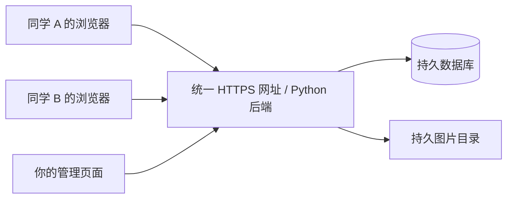

# 转角：让不同电脑看到同一批商品

## 当前结论

软件已有数据库，默认是运行后端的机器上的 `market.sqlite3`，不是把商品保存在浏览器里。浏览器只缓存登录会话、取货清单等客户端状态。

试用数据默认在仓库根的 `var-trial/`；指定 `--data` 或 `HUALI_DATA_DIR` 后以指定目录为准。图片在该目录的 `uploads/`。这些私人数据不提交 GitHub，下载仓库看到的是代码，数据库会在第一次启动时创建。

不同用户共享数据的条件是：**访问同一个后端实例，该实例使用同一个持久数据目录**。不需要让每位同学安装 Python，也不需要把数据库复制到每个人的电脑。



`127.0.0.1` 总是访问设备自己。将这个网址发给其他同学，不能让对方访问你的电脑。GitHub Pages、静态演示包也不能运行本项目的 Python 后端。

## 现在就能做的同 Wi-Fi 联调

只让一台电脑运行后端，在完整项目根目录运行：

```powershell
python "Backend mission/server.py" --trial --lan --port 8081
```

保留现用数据目录；如果原来用过 `--data`，这里也要传同一个实际目录。不要重建账号库来代替更新。

终端会打印 `http://你的局域网IP:8081`。同 Wi-Fi 的其他电脑、手机打开这一个地址。发布、下单都写入主机的数据库。主机必须开机、后端保持运行，Windows 防火墙需放行该应用的局域网访问。校园 Wi-Fi 的客户端隔离可能阻止设备互访，需要现场验证。

不要让其他同学各自双击启动一套网站，否则每人会创建各自的数据库。

## 不同网络、持续在线：集中部署

首轮计算机学院试用建议一台后端、一份持久 SQLite 和图片目录。先验证真实需求量，再评估独立数据库服务。SQLite 放在服务器上同样能供多用户共享；不能将数据库放进临时容器磁盘或公开静态目录。

现有 Render 配置位置是 **`Backend mission/render.yaml`**，不是仓库根目录。若平台支持 Blueprint 路径，请显式填写此路径；否则按下面参数创建 Web Service，不能按旧文档在仓库根查找不存在的 `render.yaml`。

| 配置 | 值 |
| --- | --- |
| 代码分支 | 当前统一分支 `master`，上线前核对包含本轮数据库修复 |
| 工作目录 | 仓库根，不要只上传前端目录 |
| 构建命令 | `pip install -r "Backend mission/requirements.txt"` |
| 启动命令 | `python "Backend mission/server.py" --trial --host 0.0.0.0 --trust-proxy` |
| 持久盘挂载 | `/var/data` |
| 数据目录环境变量 | `HUALI_DATA_DIR=/var/data/huali` |
| 网站源地址 | 平台的 `RENDER_EXTERNAL_URL`；其他平台设置实际 `HUALI_PUBLIC_ORIGIN=https://你的域名` |
| 管理员初始化 | 在平台安全环境变量界面配置自己的 `HUALI_ADMIN_PHONE` 和 `HUALI_ADMIN_PASSWORD` |
| 健康检查 | `/api/health` |
| 数据库引擎 | 本轮验收的是默认 SQLite；不要设置 `HC_DB` 来启用尚未完整验收的 MySQL |

Render Starter 和持久盘是付费资源；具体价格由开户时平台账单确定，本轮未购买或创建实例。也可以选国内云主机，由 HTTPS 代理转发到单个 Python 后端，数据放到固定目录；国内公开域名部署的备案要求按所选服务办理。

`--trust-proxy` 要求入口由可信代理控制，不能绕过入口直接访问后端端口。不要把数据库密码、服务器密码、恢复码提交到仓库或发到聊天。

已有 `start-public-8081.bat` 可尝试 Cloudflare 临时隧道，但依赖本机开机、网络和隧道服务，地址可能变化；本轮未验证实际公网隧道，不把它当持续在线服务器。

## 现有数据搬到服务器

1. 停止旧服务，保留原始 `var-trial` 完整副本；从修复后的软件生成数据库与图片完整备份。
2. 在服务器新建空的持久数据目录，恢复 `market.sqlite3` 和 `uploads/`。不要覆盖一份已经有同学发布内容的新库。
3. 启动时指定恢复目录。程序会按现用目录重新绑定图片路径。
4. 核对旧账号、商品、图片、订单，确认后再统一发新网址。

两台电脑之前各自创建的数据库不会自动合并。若两边都已有真实数据，先停写并单独制定账号、商品 ID、图片的合并方案，不直接相互覆盖。

## 已验证与上线验收

本轮使用临时数据和独立浏览器 / HTTP 客户端验证了：A 发布后 B 可浏览商品与实拍图，B 下单付款后 A 可查订单和站内通知，无关用户不能查看订单；重启后商品、订单、图片及账号会话仍保留。两份不同数据目录则互不共享。这是在同一测试机器模拟独立客户端，不是两台实体设备或公网连通性验收。

真实部署后还需用两台实际设备、不同网络重复以上流程，并重启 / 重新部署一次确认持久盘不丢数据，完成备份恢复演练。部署账户、服务器和实际公网地址尚未配置，因此不能声称网站已经上线。

自动化回归：

```bash
python -m unittest discover -s tests -p test_shared_trial_http.py -v
python -m unittest discover -s tests -p test_database_adapter.py -v
python tests/trial_browser_smoke.py
```

所有交易仍为模拟，集中部署不会自动接通微信支付。
